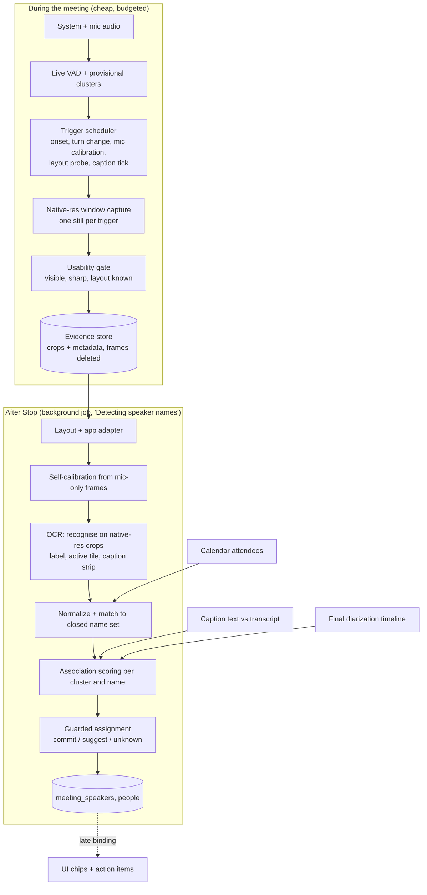

# Accurate Speaker Naming & Frame Capture Plan (Zoom, Teams, Google Meet)

> Goal: name the remote speakers correctly (and know when we are not sure) using mic + system audio, local diarization, and a small number of **well-timed, high-legibility screen captures**, on low-spec laptops.
>
> This plan builds on `TEMPORAL_OCR_AND_DIARIZATION_PIPELINE.md` (your current design). It keeps its good ideas (decoupled audio and vision, midpoint timing, voting, late binding) and fixes the places where it is likely to give wrong names or miss frames. Where it differs from `LIVE_PIPELINE_PERFORMANCE_PLAN.md` section 4.G.8, **this plan's capture design replaces that section's frame-source guidance**; keep that section's CPU budget gating.

---

## 0. TL;DR

1. **Capture on audio events, interpret later.** Take a few still screenshots at the moments the audio says "a remote person has been talking for about a second", instead of picking timestamps afterwards and seeking in a video. Timestamps then come from the live clock, so there is no video offset drift.
2. **Do not rely on the recorded video for OCR.** The recording is now 720p at 30 fps. Small name labels, especially in gallery views, are hard to read at that size. Capture the **meeting window at native resolution** for evidence and leave the recording as it is.
3. **If captions are already on, use the speaker names in them** (Teams and Meet show names; check Zoom). Matching caption text to your transcript names a voice cluster without finding any highlight border. The plan does **not** depend on captions and does not ask users to turn them on in v1.
4. **Calibrate on the one person you know: the user.** When only the mic is active, the user's own tile is the active one. Learn what "active speaker" looks like in this meeting, instead of hardcoding saturation thresholds.
5. **Score association, not just votes.** Compare how often a tile is highlighted while a cluster speaks with how often it is highlighted overall. This neutralizes pinned and spotlighted tiles.
6. **Elimination is a suggestion, not a commit.** The visible grid is rarely the full roster, and one tile can hold several speakers. The strict one-to-one Hungarian rule can produce confident wrong names.
7. **Sample adaptively.** Spend frames on the least certain speaker, stop when certain, and spread across the meeting (your stratified idea, made adaptive).
8. **Measure it.** Build a labeled test set from recordings (the user's own mic gives free labels) and calibrate thresholds so a displayed confidence means what it says.
9. **Google Meet runs mostly in a browser**, so window detection must handle Chrome, Edge and Firefox windows, the active-tab caveat and the browser chrome around the call (4.3.1).
10. **This is a beta feature**: Windows first, opt-in toggle, conservative thresholds, suggestions over commits, one-click correction, and consented evidence sharing to improve accuracy (section 14).

---

## 1. Review of the current plan: where it will likely go wrong

| # | Issue in the current design | Why it matters | Fix (section) |
| :-- | :-- | :-- | :-- |
| G1 | Frames are extracted from the **recorded video**, using audio timestamps plus a video offset | The video is 720p, WebM often seeks poorly, the file may not be final until after Stop, and offset errors move the sample off the speaker's turn | Live evidence stills at native resolution (4) |
| G2 | "Every frame contains the entire meeting grid", so the harvested roster is complete | Zoom shows 25 to 49 tiles per gallery page and pages through the rest; non-video participants can be hidden; side-by-side and floating-thumbnail layouts shrink the grid; Teams and Meet also paginate | Treat the grid as a **partial roster**; combine with calendar and captions (3, 5.5) |
| G3 | Hungarian **one-to-one** assignment and "elimination" for quiet speakers | A conference-room tile can hold several voices; one person can join on two devices; diarization splits and merges people. Elimination can then assign the only unclaimed visible name to the wrong cluster | Guarded assignment, many-to-one flags, elimination as a suggestion only (5.7) |
| G4 | Active tile found by fixed HSV thresholds (`S < 35` discard, `S >= 50` candidate) | Virtual backgrounds, colourful shared content, themes and dark mode break fixed thresholds. The thresholds are not tuned on data | Self-calibration with the user's mic, plus frame differencing (5.2, 5.3) |
| G5 | Fixed `K = 3` strata, longest segment per stratum | A quiet speaker may have no usable segment in a stratum, and a confident speaker still gets the same budget | Adaptive sampling (4.4) |
| G6 | Score `q = ocr_conf × fuzzy × purity` with thresholds 0.75 / 2 votes / 0.20 margin | The product is not a calibrated probability, adjacent frames are correlated (not independent votes), and the thresholds are untested | Association scores and calibration on a test set (5.6, 8) |
| G7 | No use of the most direct signals | Live captions with speaker names, window title, calendar attendees and the user's own mic are all cheaper and stronger than border detection | Evidence ladder (3) |
| G8 | Tile labels treated as names | Display names can be "iPhone", "Guest", a phone number, a nickname, truncated, with pronouns, or in a non-Latin script | Normalization and alias handling (5.5) |
| G9 | No retention policy for frames | Frames contain other people's faces and names | Keep crops only, delete frames (4.7) |
| G10 | No evaluation plan | You cannot tell whether changes help | Test set, metrics, calibration (8) |

---

## 2. Overview: capture on audio events, interpret later



Capture is cheap and happens live. Interpretation (OCR, scoring) happens once after Stop, so it never competes with recording on a weak CPU.

---

## 3. Evidence ladder (strongest first)

| Rank | Evidence | How you get it | Strength | Caveats |
| :-- | :-- | :-- | :-- | :-- |
| 1 | Manual rename | UI | Locked | Never overwritten |
| 2 | Mic channel = the user | Account name | Very high | Shared-room mic breaks it |
| 3 | **Live captions with speaker names** | OCR of the caption strip, matched to the transcript by text and time | High | Opportunistic: used only when captions are already on (not required, not requested in v1). Teams lets each user hide their own name in captions; caption language availability has changed over time; Meet shows name and icon beside text. Check Zoom's behaviour in your version |
| 4 | **Active-speaker tile + its name label** | Calibrated highlight detection, OCR of the label | Medium to high | Layout dependent; pinned or spotlighted views disable the normal active-speaker behaviour |
| 5 | Calendar attendees | Calendar connector | Closed set, not proof | Guests and dial-ins are missing; use to constrain, not to assign (except 1:1) |
| 6 | Participants panel (optional) | One OCR of the panel when the user opens it | High for roster | Needs a user action |
| 7 | Voice profile | Embedding match, opt-in | High | Biometric; opt-in only |
| 8 | Text cues ("Thanks, Priya") | Transcript | Low | Tiebreaker only |
| 9 | Elimination | Remaining visible names | Low | **Suggestion only** (5.7) |

Rank 3 is a bonus when captions happen to be on. It does not depend on border colour, tile position or exact timing, because the caption line contains both the name and the words, but do not plan accuracy around it.

---

## 4. Frame capture plan (the core of this document)

### 4.1 Principles

- **Capture is cheap, interpretation is deferred.** A capture is one screenshot plus a few crops written to disk. No OCR during the meeting unless budget allows (live naming, optional).
- **Resolution for evidence is independent of recording quality.** Evidence stills are native resolution. The video can be 720p at 5 fps.
- **Timing comes from the live clock.** Each still is stamped with the common clock at capture time, not computed later from a video offset.
- **Capture only when it is informative:** a remote person is speaking, or we need a calibration or layout snapshot.
- **Everything is budgeted and sheddable.** If the CPU is busy or any local queue is backlogged, captures are skipped, not queued.

### 4.2 What to capture

| Item | Format | Kept? |
| :-- | :-- | :-- |
| Meeting window at native resolution (cap very large displays, for example at 2560 px wide) | Transient image in memory | **Deleted after crops are cut** |
| **Label crops**: every visible name label, bounding box padded a few pixels | Lossless (PNG) or JPEG quality 90 or higher | Kept, small |
| **Active-tile crop** (when a highlight candidate is found) | JPEG | Kept, small |
| **Caption strip crop** (if captions are detected) | PNG | Kept, small |
| Small context thumbnail (about 320 px wide) for debugging and the layout classifier | JPEG | Kept, tiny |

### 4.3 How to capture

| Option | Resolution | Cost | Notes |
| :-- | :-- | :-- | :-- |
| **A. Native window capture in Rust** (Windows Graphics Capture for the meeting window; a crate such as `windows-capture` or `xcap`, verify features). macOS later via ScreenCaptureKit | Native | Tens of ms per still (measure on the i5-7200U) | **Recommended, and now required** (the recording is 720p). Independent of the web view and of the recorder; can target the meeting window even when partly covered (verify behaviour for minimized windows, which cannot be captured) |
| B. Grab a frame from the existing `getDisplayMedia` stream (`ImageCapture.grabFrame()` or a canvas) | 720p (the current recording setting) | Low | **Ruled out for evidence**, because the stream is now 720p and gallery labels are too small. Revisit only if the stream is ever captured at native resolution |
| C. Seek in the recorded video with FFmpeg | Video resolution | Slow on long WebM | **Fallback** for imported recordings and sessions with no live stills |

**Find the meeting window** by process and title (Windows): Zoom and Teams (desktop), and Google Meet in a browser window (4.3.1). Choose the largest visible match, record `app` and the window size, and fall back to the full display if nothing matches. Handle DPI scaling and multiple monitors, and re-detect when the window moves or resizes.

**Legibility rule:** a name label needs enough pixels to be read reliably. As a rule of thumb, aim for label text roughly 10 to 12 px high or more at capture. In dense gallery views, upscale each label crop 2x before recognition. Validate this threshold on your test set.

#### 4.3.1 Google Meet in a browser (most of your Meet users)

- **Window detection:** match Chromium-based browsers (Chrome, Edge) and Firefox windows whose title suggests a Meet call, then **validate with the layout classifier**. A title alone is unreliable: it is the active tab's title and can change. Meet installed as an app (PWA) opens its own window with its own title, so keep it in the adapter's match list.
- **Active-tab caveat:** window capture shows only the active tab. If the user switches to another tab, the frame shows a different page. The usability gate (4.5) must reject it, and capture should pause until the Meet layout is recognized again. This also protects privacy.
- **Privacy:** match titles against known patterns only. Do not store or log the titles of other windows or tabs; store only `app` and `layout`.
- **Browser chrome:** the window includes tabs, address bar and bookmarks, and their height varies. The Meet adapter must find the **call content area** from the tile grid or the call toolbar, not from fixed pixel offsets. Browser zoom and display scaling change label sizes, so record the scale and apply the legibility rule (4.3).
- **Layouts to cover first:** Meet's tiled view, spotlight or sidebar view, and presentation view (small filmstrip). Check how the active speaker is shown in each on the current Meet UI.
- **Other web clients:** Zoom or Teams in a browser need their own adapter entries if you support them later.
- **Possible later experiment:** a browser extension could read Meet's page directly (names, speaking indicators) and avoid OCR for browser calls. It adds an install step, store review, permissions and cross-browser work, and it breaks when Meet's page changes. Treat it as a phase 5 experiment, not part of the beta.

### 4.4 When to capture: trigger rules

Let `t0` be the moment the system channel's speech onset is confirmed by VAD. A remote person's active-speaker highlight typically takes a few hundred milliseconds to appear (your own document estimates 200 to 400 ms), so sample after that delay and check stability with a second frame.

```text
t0 ──── +0.8 s: still A ──── +2.0 s: still B (only if same speaker still talking) ──── end of turn
        (highlight should be on)      (stability pair: same tile highlighted in A and B)
```

| ID | Trigger | Capture | Purpose |
| :-- | :-- | :-- | :-- |
| E1 | Remote speech onset, continuous for about 0.8 s, no overlap | Still A at +0.8 s; still B at +2.0 s if the turn continues | Active-tile evidence with a stability check |
| E2 | Turn change: a new live cluster starts speaking after a pause | Still A at +0.8 s | Highest information, because the highlight must have moved |
| E3 | **Mic-only speech** for 1.5 s or more (the user is talking, the system is silent) | One still | **Calibration**: the user's tile is the active one (5.2) |
| E4 | Under-observed clusters first | Raise the priority of clusters with few observations or a low margin; back off exponentially once a cluster is resolved | Adaptive sampling |
| E5 | Layout probe every 60 to 90 s | One still regardless of speech | Roster growth, layout changes, screen-share detection |
| E6 | Captions **already on** (seen in a layout probe) | Caption strip crop every 3 to 4 s while remote speech is present | Opportunistic caption evidence (3). Never prompt the user to turn captions on in v1 |

**Adaptive sampling (replaces fixed strata):**

- Keep a running margin per cluster (best name score minus second best).
- When E1 or E2 fires, **take the capture if the cluster's margin is low or it has few observations**; otherwise skip it. Resolved clusters are re-checked rarely.
- **Spread over time:** require observations from at least 3 distinct time buckets (for example early, middle, late) before a name is auto-committed, and never take two evidence units from the same 5 s window (they are correlated).
- This keeps your good "early, mid, late" idea, but spends frames where uncertainty is, and stops when evidence is sufficient.

**Starting budgets (tune on the reference laptop):**

| Setting | Starting value |
| :-- | :-- |
| Onset delay for still A | 0.8 s |
| Gap to stability still B | 1.2 s after A |
| Minimum clean turn for E1 | 2 s |
| Max stills per minute (overall) | 6 |
| Max evidence stills per cluster | 12, across at least 3 time buckets |
| Layout probe interval | 60 to 90 s |
| Caption tick | 3 to 4 s while speech is present |
| Skip rule | Skip the capture if any local queue backlog is over threshold, CPU headroom is low, or the last capture is under 2 s old |

If the machine is too weak, drop to E1 + E3 only, or skip live capture entirely and rely on the post-Stop video-seek fallback (4.3 option C).

### 4.5 Usability gate (reject bad frames before they cost anything)

Reject or retry (up to 2 retries within 5 s) when:

- the meeting window is not visible, is minimized, or is mostly blank or black;
- the image is blurred (low sharpness measure) or in the middle of a layout transition;
- the layout adapter cannot find any plausible name labels;
- the screen is dominated by shared content (no usable tiles).

Record `usability` and the reason. A meeting with many rejected frames is flagged `visual_evidence_limited`, and the UI says names could not be detected during screen sharing instead of guessing.

### 4.6 Timeline alignment

- Stamp each still with the common clock when the capture call returns, plus the capture duration.
- At interpretation time, map the live cluster hint to the **final** cluster through the offline diarization timeline by time overlap. A still is valid evidence for cluster `c` only if `c` is the sole speaker around that timestamp (clean turn).
- Because stills carry their own timestamps, you no longer need a `video_start_offset` for OCR evidence.

### 4.7 Storage and privacy

- Keep crops and the tiny thumbnail only. Delete the full frame immediately after the crops are cut.
- Keep crops for a limited period (for example until the naming job finishes plus a retention window you choose), so OCR can be re-run with a better model.
- Debug bundles (full evidence plus decisions) only with explicit user consent, for building the test set (8).
- Other participants' faces are never needed; do not store them.

### 4.8 Fallback: post-Stop extraction from video

Keep the stratified frame selector from your current plan for imported recordings and meetings with no live stills. Use it with the improvements below (adaptive selection, native-resolution recording if available, label-crop OCR).

---

## 5. Interpreting the evidence (accuracy techniques)

### 5.1 App and layout detection (adapters as data)

- Detect the app from the window (process and title) and the layout from what is visible: speaker view, gallery, side-by-side while sharing, floating thumbnail or mini window, captions strip present.
- Keep one **adapter** per app as a JSON file: where name labels sit in a tile, which tokens to strip, where captions appear, and how the highlight is known. Adapters are data, so a vendor UI change is a config update.
- Known layout facts to encode (verify on your versions): Zoom has Active Speaker, Gallery (typically 25 up to 49 tiles per page, with paging), side-by-side while someone shares, floating thumbnail when minimized, and pin or spotlight that turns off normal active-speaker behaviour; participants without video can be hidden.
- If the layout is unknown, **skip the frame** rather than guess.

Sketch (fill values from your own recordings):

```json
{
  "app": "teams",
  "match": { "process": ["ms-teams.exe", "Teams.exe"], "title_contains": ["Microsoft Teams"] },
  "layouts": [
    { "id": "gallery",      "label": { "anchor": "bottom-left" } },
    { "id": "speaker",      "label": { "anchor": "bottom-left" } },
    { "id": "share_filmstrip" }
  ],
  "strip_tokens": ["(You)", "(Guest)", "(Host)", "(External)", "Presenting", "Muted"],
  "caption": { "roi": "bottom-band", "line_format": "name: text" },
  "highlight": { "mode": "calibrated" }
}
```

### 5.2 Self-calibration using the user's own mic

When only the mic channel is active (E3), the user's tile is the active speaker. From those frames learn, **for this meeting**:

- what the highlight looks like (colour, thickness, position relative to the tile);
- where the user's own tile and label are;
- how the app labels the user ("You", the account name, "(Me)"); add those aliases to the user's claimed set so remote clusters cannot claim the user's tile.

Then use the learned appearance for remote speakers. Fall back to adapter defaults when self-view is hidden or does not highlight. This replaces hardcoded saturation thresholds and handles themes and dark mode.

### 5.3 Active-tile detection

Combine, in order of trust:

1. **Calibrated highlight** from 5.2 (ring around a tile, matching learned colour and thickness).
2. **Frame differencing** between two stills taken during different speakers' turns: a thin ring that appears on one tile and disappears from another is the highlight, even without knowing its colour. Restrict to ring-shaped changes to ignore webcam motion.
3. **Adapter-specific cues**, if available (for example an animated audio indicator on the tile).

Accept an observation only when the **stability pair** (still A and still B) agrees on the tile. Disagreement means a transition or crosstalk; drop it.

### 5.4 OCR on crops, not whole frames

- Locate text boxes at low resolution, then **recognise on native-resolution crops**, upscaled about 2x for small labels. RapidOCR can run recognition only on a crop (check your version); the Windows built-in OCR is a free comparison. Pick by accuracy on your test set.
- Check script coverage. Default OCR models are strongest for Latin text; if display names use Devanagari, Gujarati, Arabic or CJK, verify the recognition model's language support and test it.
- Use confusion-aware normalization (`l/I/1`, `0/O`, `rn/m`).
- **Consensus across frames:** merge observations whose edit distance is small and prefer the longest consistent string. A truncated label ("Priya Sha...") is matched as a prefix, not discarded.

### 5.5 Name normalization and matching

- Strip UI tokens: `(You)`, `(Guest)`, `(Host)`, `Presenting`, `Muted`, pronouns, role badges.
- Build the **closed name set** from, in order: calendar attendees, the person alias table (`people.aliases`), names seen in labels and captions in this meeting. Match against it with Jaro-Winkler plus token-level matching (first name plus initial).
- Names that match nothing are kept as `raw_ocr_name` suggestions, never auto-committed as people.
- Treat these label types specially: phone numbers and "iPhone" or "Guest" (valid labels, but not matchable to a person), room names (shared tile, see 5.7), and renamed participants (a name that changes mid-meeting is treated as one tile if the highlight pattern continues).
- The grid is a **partial roster** (G2). Record `meeting_roster` with a `source` (calendar, grid, panel, caption) so the assignment step knows how complete it is.

### 5.6 Evidence aggregation: association, not vote counting

**Observation unit.** Group frames within the same 5 s turn into one unit, so correlated frames do not count as independent votes. Use only units with exactly one speaking cluster (clean turns).

**Highlight association.** For each cluster `c` and name `n`:

```text
N_c      = number of clean units where cluster c speaks
k_{c,n}  = number of those units where n was the highlighted tile (stability pair agreed)
share    = k_{c,n} / N_c
p_n      = fraction of ALL clean units (any cluster) where n was highlighted
lift     = share / max(p_n, epsilon)
```

A tile that is highlighted all the time (pinned, spotlighted, or the only tile) has `lift` near 1 and carries no evidence. High `share` with high `lift` is strong evidence. Combine with OCR confidence of the label and the match score. Starting formula only; **calibrate** it (8).

**Caption association (rank 3, opportunistic).** For each caption crop, OCR the name and the first few words. Fuzzy-match those words to the transcript segments within a few seconds. The segment's final cluster `c` plus the caption's name `n` is a direct observation `(c, n)`, with weight above highlight evidence. Ignore captions that carry no name (for example when a user hid theirs).

**Calibration of scores.** Fit a mapping from combined score to empirical precision on the test set (for example isotonic regression), so "0.9" means about 90% of such assignments were right. Set the auto-commit threshold from a target precision, not from a hand-picked number.

### 5.7 Guarded assignment

| Situation | Action |
| :-- | :-- |
| One name clearly dominates a cluster (calibrated score above the commit threshold, at least 3 evidence units across at least 3 time buckets) | **Commit** (`name_source = 'ocr'` or `'caption'`) |
| Evidence is plausible but below the threshold | **Suggest** (one-click chip) |
| Two clusters map to the same name | Do not commit either; **suggest a merge** (one person split by diarization, or one person on two devices) |
| One cluster shows two names with comparable strength | **Suggest a split** (two people merged by diarization) and do not commit |
| Two clusters share one tile (conference room) | Allow many-to-one: label both as members of that tile, for example "Room 3 (Speaker 4)" |
| Name left only by elimination | **Suggest only**, never auto-commit |

**Elimination rule.** Allow elimination to *suggest* a name only when all of these hold: the roster is verified complete (calendar plus panel or captions), the number of unresolved clusters equals the number of unclaimed names after removing people who could not have spoken, and each unresolved cluster has enough clean speech. Otherwise leave the cluster unnamed.

Use Hungarian assignment only as a tie-solver among candidates that already pass the thresholds, not to force a match.

### 5.8 Closed loop with diarization

Naming evidence tells you about diarization errors. Use it to improve the speaker list: same name on two clusters suggests a merge; two strong names in one cluster suggests a split. Show both in the existing merge/split UI.

### 5.9 Shortcuts that improve accuracy for free

- **1:1 meetings.** Two attendees in the calendar and one remote cluster: suggest the other attendee with high confidence, and auto-commit if the window title or a label agrees.
- **Small meetings.** With 3 or 4 attendees from the calendar, the closed set is tiny, so label matching is easier and eliminations are safer.
- **Recurring meetings.** Use the previous occurrence's roster as a prior for tie-breaking only, never as evidence.

---

## 6. App-by-app notes (verify on current versions)

| App | What to rely on | Watch out for |
| :-- | :-- | :-- |
| **Zoom** | Layouts: Active Speaker, Gallery (typically 25 up to 49 tiles per page, with paging), side-by-side while someone shares, minimized floating thumbnail. Active speaker is highlighted in gallery. Pin and spotlight disable the normal active-speaker behaviour. Names show on tiles; non-video participants can be hidden | Gallery paging means a partial grid. Hidden non-video tiles. Display names often edited ("iPhone", nicknames). Check whether Zoom's captions or transcript panel show names in your version |
| **Microsoft Teams** | Live captions show the speaker's name beside the text. Desktop client (new and classic UIs differ) | Each user can hide their own name in captions. Caption language availability has changed over time. UI differs between new and classic clients, so keep adapters versioned |
| **Google Meet** | Used mostly **in a browser** by your users (Chrome, Edge, Firefox, some installed-as-app windows). When captions are on, they show the speaker's name and icon beside the text | Active-tab caveat; browser chrome around the call; browser zoom level; the window title is the tab title; the captions bar changes the layout (video moves up) |

These are descriptions from public documentation. Treat each as a hypothesis to confirm with recordings of your own meetings, because UIs change often.

---

## 7. Hard cases and what happens

| Case | Handling |
| :-- | :-- |
| User presents (shares screen) | The meeting UI may be hidden. Use captions, calendar, and the user's rename. Mark `visual_evidence_limited`; do not guess |
| Someone else presents | Side-by-side or filmstrip layouts show small tiles. Use higher upscaling; prefer captions |
| Camera off, avatar or initials only | Label may still show the name; if only initials, match as a prefix against the closed set, else suggest |
| Gallery paging (more tiles than one page) | Treat as a partial roster; use captions and calendar; layout probes may reveal other pages |
| Pinned or spotlighted tile | `lift` near 1, so that tile contributes no evidence |
| Conference room tile with several speakers | Many-to-one flag (5.7) |
| One person on two devices | Merge suggestion |
| Dial-in or phone number labels | Kept as a label, not matched to a person unless an alias exists |
| Participant renames mid-meeting | Track by position and highlight pattern; update the alias |
| Late joiners and early leavers | Time-bucketed evidence; do not apply a name to turns before that person's tile appeared |
| Non-Latin or mixed-script names | Check recognition model coverage (5.4); keep the raw string |
| Dark mode, themes, virtual backgrounds | Self-calibration (5.2), differencing (5.3) |
| High DPI and multi-monitor | Capture the window, not the display; record scale; re-detect on resize |
| Meeting app minimized | Window capture may fail; fall back to the floating thumbnail if visible; else skip |
| User switches the browser to another tab during a Meet call | Frame rejected by the usability gate; evidence resumes when the Meet layout is visible again |

---

## 8. Evaluation and calibration (do this first)

**Test set:** 20 to 30 recorded meetings, balanced across Zoom, Teams and Meet, and across layouts (speaker, gallery, share), meeting size (2, 4, 8, 15+), camera on and off, light and dark themes, captions on and off. You can get ground truth cheaply:

- **Free labels from the user's own mic:** whenever only the mic is active, the user's tile is the active tile. Use this to test the highlight detector with no hand labelling.
- **Hand labels for remote speakers:** for each cluster, the correct name. A 20 to 30 minute labelling pass per meeting-hour is realistic.
- **Consented debug bundles** from real use (4.7), added over time.

**Metrics (report per app, layout and meeting size):**

| Metric | Why |
| :-- | :-- |
| **Auto-commit precision** (committed names that are right) | The most important number. A wrong name quietly corrupts accountability |
| Coverage (clusters that got a name or a correct suggestion) | Measures usefulness |
| Wrong-commit rate | Set a target and tune thresholds to meet it |
| Time to first name (live naming) and after Stop | UX |
| Frames used per meeting, bytes stored, CPU time | Cost on the reference laptop |
| Highlight detector accuracy on mic-only frames | Isolates detection from naming |

**Ablations to run:** native-resolution stills versus video seeking; adaptive versus fixed strata; captions on versus off; calibrated highlight versus fixed HSV; one-to-one forced versus guarded assignment; OCR engine comparison.

**Calibration:** fit score to precision (5.6) and choose commit and suggest thresholds for your target precision. Re-run after every adapter or model change using stored crops, so regressions are caught without new meetings.

---

## 9. Resource plan for low-spec laptops (reference: i5-7200U, 16 GB, no usable GPU)

- **Live cost:** a window capture and a few crop writes per trigger, at most about 6 per minute. Measure per-capture time on the reference laptop. Caption crops add a small cost; they are the first thing to shed.
- **Recording runs at 720p and 30 fps** (your current setting). That is a much larger encode load than the 5 fps setting in the performance plan, so evidence captures compete with it on a 2-core CPU. Measure capture time and live lag with recording on (Phase 0 metrics). If lag appears, lowering fps is the cheapest lever, and the evidence stills are unaffected because they do not come from the recording.
- **After Stop cost:** recognition on tens to a few hundred small crops in a background job at below-normal priority, with a "Detecting speaker names…" status. Your doc cites under 35 ms per frame for RapidOCR; measure it on the reference laptop with crops.
- **Governor rules:** no capture when a local queue is backlogged or CPU headroom is low; stop live capture before anything affects audio; defer interpretation while a new recording is active.
- **First-run capability check:** include a still-capture timing test and a crop OCR timing test, then choose a capture tier: full (E1 to E6), minimal (E1 and E3), or none (post-Stop video fallback only).
- **Storage:** crops and thumbnails only, so a meeting's evidence is a few megabytes (verify on real data).

---

## 10. Data model additions

Works with the existing `meeting_speakers` and `people` tables from the speaker-identity plan.

```sql
CREATE TABLE speaker_evidence_frames (
  id               UUID PRIMARY KEY DEFAULT gen_random_uuid(),
  meeting_id       TEXT NOT NULL REFERENCES meetings(id) ON DELETE CASCADE,
  captured_at_ms   BIGINT NOT NULL,                 -- common clock
  trigger          TEXT NOT NULL CHECK (trigger IN
                   ('turn_onset','turn_change','mic_calibration','layout_probe','caption','video_seek')),
  app              TEXT,
  layout           TEXT,
  usability        REAL,
  live_cluster_hint TEXT,                           -- provisional; remapped via final diarization
  crops            JSONB NOT NULL,                  -- [{kind:'label'|'active_tile'|'caption'|'context', path, bbox}]
  created_at       TIMESTAMPTZ NOT NULL DEFAULT NOW()
);

CREATE TABLE name_observations (
  id            UUID PRIMARY KEY DEFAULT gen_random_uuid(),
  frame_id      UUID NOT NULL REFERENCES speaker_evidence_frames(id) ON DELETE CASCADE,
  meeting_id    TEXT NOT NULL,
  region_kind   TEXT NOT NULL CHECK (region_kind IN ('label','caption')),
  name_raw      TEXT,
  name_norm     TEXT,
  ocr_conf      REAL,
  match_score   REAL,
  is_highlighted BOOLEAN,                           -- label belongs to the highlighted tile
  caption_text  TEXT                                -- first words, for matching to the transcript
);

CREATE TABLE meeting_roster (
  meeting_id  TEXT NOT NULL REFERENCES meetings(id) ON DELETE CASCADE,
  name_norm   TEXT NOT NULL,
  source      TEXT NOT NULL CHECK (source IN ('calendar','grid','panel','caption')),
  seen_count  INT  NOT NULL DEFAULT 1,
  PRIMARY KEY (meeting_id, name_norm, source)
);

-- meeting_speakers: add fields used by guarded assignment
ALTER TABLE meeting_speakers
  ADD COLUMN evidence_units   INT,
  ADD COLUMN evidence_buckets INT,
  ADD COLUMN tile_note        TEXT;                 -- e.g. 'shared tile: Room 3'
```

Example evidence record (what each capture leaves behind):

```json
{
  "captured_at_ms": 1843200,
  "trigger": "turn_onset",
  "app": "zoom",
  "layout": "gallery",
  "usability": 0.92,
  "live_cluster_hint": "sys:S2",
  "crops": [
    { "kind": "label",       "path": "ev/9c1/l1.png", "bbox": [412, 301, 260, 34] },
    { "kind": "active_tile", "path": "ev/9c1/t1.jpg", "bbox": [380, 180, 560, 330] }
  ]
}
```

---

## 11. Development tasks and rollout

| ID | Task | Area | Done when |
| :-- | :-- | :-- | :-- |
| N0 | Build the labeled test set and the metrics harness (8) | QA | Baseline numbers for the current pipeline per app and layout |
| N1 | Meeting-window finder (Zoom, Teams, and Meet in Chrome, Edge and Firefox) and native window capture; Windows only for the beta | Rust | A still of the call window at native resolution in tens of ms on the reference laptop; wrong-tab frames rejected |
| N2 | Trigger scheduler (E1 to E6), budgets, skip rules, adaptive priority | Rust | Frames per minute within budget; no added local queue backlog |
| N3 | Usability gate and retry logic | Rust | Bad frames rejected; `visual_evidence_limited` flag works |
| N4 | Evidence store: crops, thumbnail, frame deletion, retention | Rust | No full frames on disk after crops are cut |
| N5 | App adapters as JSON (Meet in a browser first, then Zoom and Teams) and the layout classifier, including browser-chrome handling | Rust, data | Layout recognized on the test set; unknown layouts skipped |
| N6 | Self-calibration from mic-only frames; calibrated highlight; frame differencing | Sidecar or Rust | Highlight detector accuracy on mic-only frames meets target |
| N7 | OCR on crops (recognise-only, upscale), engine comparison, confusion-aware normalization, multi-frame consensus | Sidecar | OCR accuracy on label crops measured and chosen |
| N8 | Name matching against closed sets, alias table, roster with sources | Rust | Matching precision measured |
| N9 | Opportunistic caption evidence (only when captions are already on): detection, strip OCR, transcript matching | Sidecar, Rust | Caption-derived names correct on caption-on meetings |
| N10 | Association scoring, calibration, guarded assignment, merge and split suggestions | Rust | Commit precision meets the target at useful coverage |
| N11 | UI: suggestion chips, confidence and reason ("Matched from captions", "Seen as active speaker 5 times"), `visual_evidence_limited` message | Frontend | A user can accept or correct a name in one click |
| N12 | Post-Stop video-seek fallback with adaptive selection (imports, no live stills) | Rust | Imported recordings get names with the same scoring |
| N13 | Beta controls: opt-in toggle, conservative thresholds, correction logging, consented evidence sharing, kill switch (section 14) | Frontend, Rust | A tester can turn the feature on or off, and every accept, reject or rename is recorded locally |

**Phases and exit criteria**

| Phase | Work | Exit criteria |
| :-- | :-- | :-- |
| 0 | N0 | Baseline measured; failure modes ranked from real meetings |
| 1 | N1 to N4 | Live evidence capture works within budget on the reference laptop |
| 2 | N5 to N8 | Interpreter v2 beats the baseline on highlight and label accuracy |
| 3 | N10 | Association scoring and guarded assignment reach the target auto-commit precision at useful coverage |
| 4 | N11, N12, N13 | UI, fallback and beta controls complete |
| 5 (optional) | N9 (opportunistic captions), participants-panel capture, accessibility or UI-automation cues, browser-extension experiment for Meet, voice profiles, macOS support | Only if the test set shows remaining gaps |

Build phases 0 and 1 first. The test set tells you where the real errors are before you invest in more detection logic.

---

## 12. Risks

| Risk | Mitigation |
| :-- | :-- |
| Native capture behaves differently per OS, window state or GPU | Windows first; fall back to display capture and then to video seek; test minimized and occluded windows |
| Vendor UI changes break adapters | Adapters as data, versioned, regression-tested from stored crops |
| Users will not turn on captions | Captions are an accuracy boost, never a requirement; the highlight path works without them |
| Wrong names committed | Calibrated thresholds, multi-bucket requirement, suggestions instead of commits, merge/split loop, user confirmation |
| Capture adds CPU load on weak laptops | Budgets, skip rules, capture tiers from the first-run check, shed first |
| Privacy of other participants | Crops only, delete frames, no faces stored, consented debug bundles |
| Display names that are not real names | Closed set from calendar, alias table, raw names kept as suggestions |
| Beta testers see wrong names | Conservative thresholds, suggestions instead of commits, visible confidence and source, one-click correction (section 14) |
| Meet tab not in front, or browser layout differs by browser | Usability gate, layout validation, per-browser tests on the test set |

---

## 13. Decisions from your answers, and what is still open

| Question | Your answer | Decision |
| :-- | :-- | :-- |
| Can the product ask users to turn on live captions? | "I am using just STT for transcription" | I read this as: captions are not part of your pipeline, so naming must work without them. Captions become an **opportunistic bonus** (used only if already on). No prompts in v1. N9 moves to the optional phase |
| Meet in a browser or an installed app? | Mostly the website | Meet in a browser is a first-class adapter: Chrome, Edge and Firefox windows, the active-tab caveat, browser chrome, validation by layout (4.3.1) |
| Windows only for the first release? | Beta feature; accuracy not guaranteed | Assumed: **Windows only for the beta**, macOS later. Beta controls in section 14 |
| Is recording kept at native resolution anywhere? | Recording is now 720p at 30 fps | Not at native resolution. Native window stills are required (option B ruled out). Measure CPU with 720p30 recording on (section 9) |

**Still open:**

1. Is "Windows only for the beta" right? I assumed it from your reference laptop; macOS would need ScreenCaptureKit and a screen-recording permission flow.
2. Which browsers must Meet support at launch: Chrome, Edge, Firefox, others?
3. Is 30 fps needed for playback quality, or can it be lowered on weak laptops if live lag appears?
4. After a wrong name, should beta testers be offered a way to share the naming evidence (label crops only), and how should that consent work?

---

## 14. Beta rollout and expectations

This feature cannot be 100% accurate, and in some meetings it cannot work at all (screen sharing, hidden names, paged grids). Design the beta around honesty and learning.

- **Opt-in toggle:** "Automatic speaker names (beta)" in settings, off by default during the beta, with one plain sentence about what it does and its limits. Keep a kill switch (a local setting, and a remote flag if you have one). The feature disables itself when the first-run capability check chooses the "none" tier.
- **Honest UI, three states:** named (a check mark, with the reason on hover, for example "Seen as the active speaker 5 times"), suggested (a chip the user can accept), and unknown (`Speaker N`). Never present a suggestion as a fact.
- **Conservative defaults:** set the auto-commit threshold for high precision. In the first beta weeks, consider commit-only for the clear cases (the mic is the user; a 1:1 meeting) and suggestions for everything else. Relax thresholds only as the measured wrong-commit rate allows.
- **Corrections are the best data:** record locally every accept, reject and rename as an outcome plus `app`, `layout` and the evidence types used, with no meeting content. Sharing is opt-in.
- **Consented evidence sharing:** after a wrong name, offer "Help improve speaker naming". Show a preview of exactly what would be shared (crops of name labels only, never full frames or faces), and require explicit consent for each upload.
- **Beta success metrics:** precision of committed names (from corrections), share of speaking time labelled correctly, correction rate, CPU and lag impact on weak laptops, and opt-out rate.
- **Plain-language limits** in the UI: works best when participant names are visible on screen; accuracy drops during screen sharing, with paged grids and with a pinned speaker.
- **Scope:** Windows. Meet in a browser, Zoom and Teams desktop. Everything else degrades gracefully (unknown layouts are skipped, never guessed).
- **Exit criteria for leaving beta:** the auto-commit precision target is met on the test set and in the field over a meaningful number of meetings, CPU impact stays within budget, and the correction rate is acceptable.

---

## References

- Zoom help pages on video layouts: Active Speaker, Gallery (25 to 49 tiles per page with paging), side-by-side during screen sharing, pin and spotlight, hide non-video participants, floating thumbnail.
- Microsoft support and Teams documentation on live captions with speaker attribution, including the user setting that hides your own name in captions.
- Reporting that compares Google Meet and Teams captions: Meet shows the speaker's name and icon beside caption text.
- Your own `TEMPORAL_OCR_AND_DIARIZATION_PIPELINE.md` (current design) and `LIVE_PIPELINE_PERFORMANCE_PLAN.md` (performance, capture tiers, first-run check).
