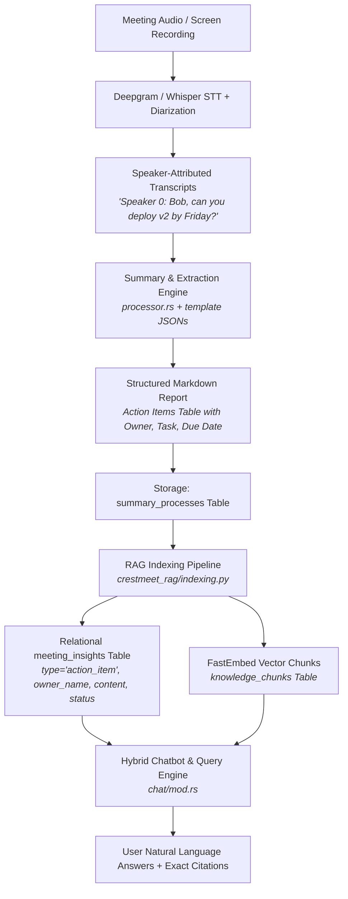

# Action Items Capture & Task Assignment Architecture

> **Comprehensive Report on how CrestMeet captures action items, resolves task assignments (Who assigned work to Whom), and tracks deliverables.**

---

## 1. Executive Summary

In CrestMeet (Meetily), capturing action items and determining work assignment is handled through an **end-to-end multi-stage pipeline**:

1. **Speaker Diarization & Attribution**: Audio is transcribed with speaker separation (`Speaker 0`, `Speaker 1`, or named participants). Every utterance is explicitly prefixed with the speaker tag and timestamp.
2. **Contextual LLM Extraction**: Structured prompt templates enforce extraction of tasks, assigned owners, due dates, and supporting transcript quotes.
3. **Conversational Intent Disambiguation**: The AI analyzes the dialogue turns to differentiate between:
   - **Assigner (Who requested/delegated)**: The speaker initiating the request or defining the requirement.
   - **Assignee / Owner (To whom it is assigned)**: The person addressed, agreed upon, or volunteering for the task.
   - **Work Item (Which work)**: The concrete deliverable, action, or milestone.
   - **Deadline / ETA (When)**: Relative or absolute timeline constraints.
4. **Relational & Vector Persistence**: Extracted action items are stored both in human-readable Markdown tables and indexed into the structured relational database (`meeting_insights`) with vector embeddings for instant semantic search.
5. **Interactive RAG Chatbot**: Team members can query cross-meeting assignments in natural language (e.g., *"What did Sarah assign to David?"*, *"List all open action items for frontend"*), backed by exact meeting timestamps and citations.

---

## 2. End-to-End Pipeline Architecture



---

## 3. Step-by-Step Breakdown

### Step 1: Speaker Diarization & Audio Attribution
* **Files:** [`deepgram/client.rs`](file:///c:/Projects-Crest/meetily/frontend/src-tauri/src/deepgram/client.rs), [`audio/import.rs`](file:///c:/Projects-Crest/meetily/frontend/src-tauri/src/audio/import.rs)
* Before analyzing *what* was assigned, the system must know *who spoke*.
* During live recording or audio import, Deepgram or local STT applies **speaker diarization**.
* Word-level time offsets and speaker clustering generate segment transcripts:
  ```rust
  let display_text = if let Some(spk) = &ds.speaker {
      format!("{}: {}", spk, ds.transcript)
  } else {
      ds.transcript
  };
  ```
* Every chunk fed to the AI carries the speaker identification and start/end timestamps.

---

### Step 2: Speaker Disambiguation (Who Assigns Work to Whom)

How does the AI determine **who gave the task** and **who received it**?

The system uses LLM conversational role analysis across transcript turns:

| Entity | How It Is Figured Out | Linguistic Signals / Examples |
| :--- | :--- | :--- |
| **Assigner** | Identified from the **Speaker tag of the requesting turn**. | *"Speaker 0: John, please ensure..."*, *"Alex: Can you follow up with the client?"* |
| **Assignee (Owner)** | Identified from **vocative address**, **direct agreement**, or **self-assignment**. | • *Direct delegation:* "David, can you review the PR?" $\rightarrow$ David<br/>• *Self-volunteering:* "I'll handle the API schema" $\rightarrow$ Speaker of that turn<br/>• *Mutual consensus:* "Let's have Sarah lead this" $\rightarrow$ Sarah |
| **The Work / Task** | Extracted from the **verb phrase and object** of the agreement. | *"migrate database to Supabase"*, *"prepare pitch deck for Tuesday"* |
| **Due Date / ETA** | Resolved from **temporal phrases** relative to the meeting date. | *"by EOD Friday"*, *"next Tuesday at 3 PM"*, *"before the sprint ends"* |
| **Verification Quote** | Anchored to the **exact sentence & timestamp** in the audio. | `"04:15 - Alex: I will ship the migration script tomorrow"` |

---

### Step 3: Template-Driven LLM Extraction Prompts
* **Files:** [`standard_meeting.json`](file:///c:/Projects-Crest/meetily/frontend/src-tauri/templates/standard_meeting.json), [`project_sync.json`](file:///c:/Projects-Crest/meetily/frontend/src-tauri/templates/project_sync.json), [`processor.rs`](file:///c:/Projects-Crest/meetily/frontend/src-tauri/src/summary/processor.rs)

The summary engine enforces structured action item tables using pre-configured meeting templates:

#### Standard Meeting Template Configuration:
```json
{
  "title": "Action Items",
  "instruction": "List all assigned tasks with their owners and due date. Always add reference transcript segment and timestamp in the table.",
  "format": "list",
  "item_format": "| **Owner** | Task | Due | Reference Transcript Segment | Segment Time stamp |\n| --- | --- | --- | --- | --- |"
}
```

#### Project Sync Template Configuration:
```json
{
  "title": "Action Items",
  "instruction": "Tasks with owners, due dates, priority, and status",
  "format": "list",
  "item_format": "| **Owner** | **Task** | **Due Date** | **Priority** | **Status** |\n| --- | --- | --- | --- | --- |"
}
```

#### Sales & Client Call Template Configuration:
```json
{
  "title": "Agreed Deliverables",
  "instruction": "Deliverables, owners, and due dates",
  "format": "list",
  "item_format": "| **Deliverable** | **Owner** | **Due Date** |\n| --- | --- | --- |"
}
```

---

### Step 4: Storage in PostgreSQL / Supabase
* **Files:** [`manager.rs`](file:///c:/Projects-Crest/meetily/frontend/src-tauri/src/database/manager.rs), [`indexing.py`](file:///c:/Projects-Crest/meetily/services/rag_service/src/crestmeet_rag/indexing.py)

Once the meeting summary is generated:
1. **Raw Summary Document**: Stored in `summary_processes.result`.
2. **Structured Insight Extraction**: The indexing service parses the action items into individual relational rows in `meeting_insights`:

```sql
CREATE TABLE meeting_insights (
    id UUID PRIMARY KEY DEFAULT gen_random_uuid(),
    project_id UUID NOT NULL REFERENCES projects(id) ON DELETE CASCADE,
    meeting_id TEXT NOT NULL REFERENCES meetings(id) ON DELETE CASCADE,
    type TEXT NOT NULL CHECK (type IN ('decision', 'action_item', 'risk', 'question', 'deadline', 'key_point')),
    content TEXT NOT NULL,          -- The specific task / deliverable description
    owner_name TEXT,                -- The assignee / worker name
    owner_user_id UUID,             -- Optional mapped user UUID
    due_date DATE,                  -- Resolved calendar deadline
    status TEXT NOT NULL DEFAULT 'open' CHECK (status IN ('open', 'in_progress', 'done', 'dropped')),
    source_chunk_id UUID REFERENCES knowledge_chunks(id),
    start_seconds FLOAT8,           -- Exact audio offset
    embedding VECTOR(384),          -- BAAI/bge-small-en-v1.5 embedding
    fts TSVECTOR GENERATED ALWAYS AS (to_tsvector('english', content)) STORED,
    created_at TIMESTAMPTZ NOT NULL DEFAULT NOW()
);
```

---

### Step 5: Querying "Who Assigned What to Whom" via AI Chatbot
* **File:** [`frontend/src-tauri/src/chat/mod.rs`](file:///c:/Projects-Crest/meetily/frontend/src-tauri/src/chat/mod.rs)

When a user asks:
> *"Who assigned work to David in yesterday's meeting and what does he need to do?"*

The retrieval engine combines **two synchronized data sources**:

1. **Relational Insight Lookup (`fetch_scoped_insights`)**:
   Pulls all structured action items scoped to the user's active project:
   ```sql
   SELECT mi.meeting_id, m.title, mi.type, mi.content, mi.owner_name
   FROM meeting_insights mi
   JOIN meetings m ON m.id = mi.meeting_id
   WHERE mi.project_id = ANY($1) AND m.user_id = $2
   ORDER BY mi.created_at DESC
   LIMIT 20;
   ```
2. **Hybrid Semantic & Keyword Search (`search_knowledge_chunks`)**:
   Searches raw transcript chunks containing the dialogue where the assignment happened.
3. **Context Injection & Synthesis**:
   The engine formats both the structured insights and raw speaker chunks into the LLM synthesis context:
   ```text
   === IDENTIFIED ACTION ITEMS & DECISIONS ===
   - [ACTION_ITEM] from "Sprint Planning" (ID: m-01): Deploy v2 migration (Owner: David)

   === RELEVANT MEETING KNOWLEDGE & TRANSCRIPT CHUNKS ===
   [S1] Meeting: "Sprint Planning" (Date: 2026-10-12, Speakers: Sarah, David)
   [14:10-14:35]
   Sarah: David, can you take ownership of the v2 database migration by Wednesday?
   David: Yes, I will write the migration script and test it on staging first.
   ```
4. **Answer Output**:
   The LLM reports:
   > **Sarah** assigned the **v2 database migration** to **David** during the *Sprint Planning* meeting. David agreed to write the migration script, test on staging, and deploy it by Wednesday [S1].

---

### Step 6: Follow-Up & Rescheduling Tracking
* **File:** [`frontend/src-tauri/src/summary/reschedule_extractor.rs`](file:///c:/Projects-Crest/meetily/frontend/src-tauri/src/summary/reschedule_extractor.rs)

In addition to individual action items, task accountability often involves future check-in meetings.
The `api_extract_reschedule_info` command parses transcripts to detect agreed check-ins:
* Extracts meeting title (e.g., *"Follow-up: Database Migration Review"*).
* Computes target date and time.
* Extracts participating attendees.
* Preserves the verbatim transcript quote confirming the follow-up.

---

## 4. Concrete Example

### Input Transcript Dialogue:
```text
[00:12:15] Alex (Tech Lead): We need someone to update the Stripe billing webhook handler before Friday's release.
[00:12:22] Maya: I can take that. I worked on the Stripe integration last quarter.
[00:12:28] Alex: Great. Maya, please make sure the test cases cover duplicate event IDs as well.
[00:12:35] Maya: Will do, I'll have the PR open by Thursday afternoon.
```

### Resulting Captured Action Item:

| Field | Captured Value | Method |
| :--- | :--- | :--- |
| **Assigner** | **Alex (Tech Lead)** | Extracted from the speaker initiating request and setting criteria |
| **Assignee (Owner)** | **Maya** | Extracted from voluntary commitment and direct address |
| **Work Item / Task** | Update Stripe billing webhook handler with duplicate event ID tests | Synthesized from dialogue scope |
| **Due Date** | Thursday afternoon (prior to Friday's release) | Contextual date extraction |
| **Timestamp Citation** | `12:15 - 12:35` | Segment timecode |
| **Status** | `open` | Initial insight status |

---

## 5. Summary of System Benefits

- **No Manual Notes Required**: Commitments made verbally during discussions are automatically converted into structured tasks.
- **Clear Accountability**: Both the requester (assigner) and the owner (assignee) are tracked.
- **Direct Audio Grounding**: Every item links directly back to the timestamped segment in the transcript, preventing disputes over what was agreed.
- **Searchable via Natural Language**: Chatbot answers queries like *"What are my pending tasks?"* or *"What did I promise to deliver to the client?"* instantly with full context.
