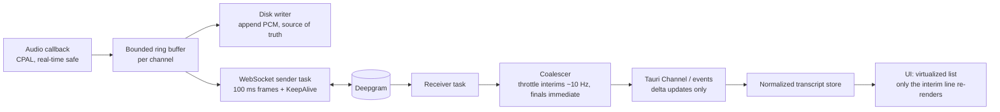
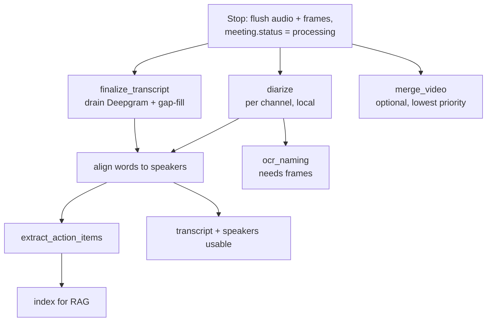
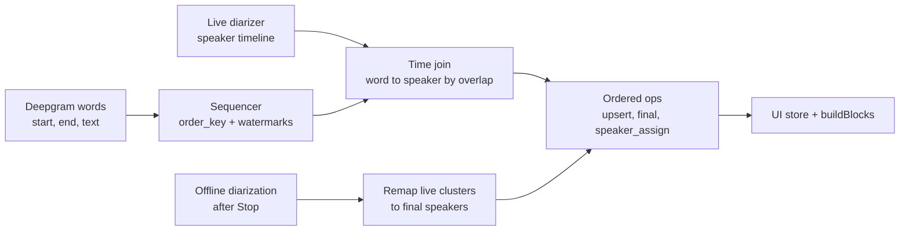

# Live Pipeline Performance & Stop-Pipeline Plan (Deepgram live STT)

> Goal: live transcript with low, *measured* lag; **Stop** returns the user to a usable meeting page in about a second; every heavy step (diarization, OCR naming, task extraction, indexing, video merge) runs in the background as a resumable job.
>
> This plan is **separate from** `SPEAKER_IDENTITY_AND_ASSIGNMENT_PLAN.md`. That plan's features (diarization, OCR naming, late-binding action items, My Tasks) are already implemented. This file only changes how they are **orchestrated and scheduled**.

---

## 0. TL;DR

1. **STT compute is remote** (Deepgram over one persistent WebSocket with continuous 100 ms frames and KeepAlive). So the local-Whisper bottleneck analysis in `PIPELINE_ARCHITECTURE_AND_BOTTLENECKS.md` (`NUM_WORKERS = 1`, serial inference) most likely does **not** apply to Deepgram sessions. Verify which code path a Deepgram session takes (section 8).
2. **The long wait after Stop is almost certainly local post-processing run synchronously**: diarization, the blocking `uv run` indexing subprocess, an FFmpeg merge that is **confirmed to re-encode the whole video**, plus waiting on the transcript. The fix is an **async job pipeline**, not faster STT.
3. **Live "buffering" has a different set of suspects**: local CPU starvation (1080p30 software video encoding), blocked async threads, late finalization because of endpointing settings, and **UI re-rendering on every interim result**. Do not guess; add three lag measurements first (section 3).
4. **Treat the audio on disk as the source of truth and the transcript as rebuildable.** That makes Stop cheap, survives crashes and network drops, and lets a background job fill any gap.
5. **Replace `uv run` per meeting with one long-lived, warm Python sidecar** with an async job API. Decide later, with measurements, whether to port pyannote to ONNX.
6. **Screen capture is the biggest avoidable local cost, and it must stay** (playback is a product feature). Cut the rate and resolution now, then move to a hardware-encoded video path with a stream-copy merge (4.D).
7. **Reference hardware is an i5-7200U (2 cores / 4 threads), 16 GB RAM, no usable GPU.** Everything must run CPU-only, and every local live stage needs a real-time factor (RTF) well under 1. There is no local STT or LLM, so "it keeps processing old audio after Stop" is either a **full-audio offline pass after Stop** (pyannote diarization and embeddings over the whole recording), a **local live queue slower than real time**, or both, plus the video re-encode in the merge. Phase 0 timings decide which; cap every local live queue regardless (sections 1.1 and 3).
8. **Live speaker-grouped transcript with streaming text and strict ordering** (4.G): order is defined by time and never depends on diarization; the speaker is a label that can arrive late; diarization is two-tier (cheap live clusters, accurate offline pass); text appears with an adaptive typewriter reveal whose lag is bounded.
9. **No audio is ever dropped at Start or Stop** (4.A): pre-roll buffering at Start, drain-then-finalize at Stop, and a coverage check that recovers any gap from the saved audio.
10. **Live naming is accepted** (4.G.8): one OCR attempt on a frame when a live cluster first becomes stable, as an early suggestion. The post-Stop OCR pass on the recorded video stays authoritative.

---

## 1. What we know and what the evidence says

| Fact | Implication |
| :-- | :-- |
| Live STT = Deepgram WebSocket, 100 ms raw frames, KeepAlive, server VAD + endpointing | STT inference does not use the user's CPU. Lag can still come from sending late, receiving late, or rendering late |
| REST is used only for "Import Audio File" | Reusable for **gap-filling** missing ranges after Stop |
| Screen capture: Chromium `MediaRecorder`, 1920x1080 at 30 fps, VP9 software encode (`useScreenRecording.ts:75-97`) | Heavy CPU and memory-bandwidth load that competes with audio capture, resampling, WebSocket I/O and the UI |
| Stop waits for "all transcription chunks" (`recording_commands.rs:658-690`, `useRecordingStop.ts:174-200`) | Need to confirm what this waits for on a Deepgram session |
| `save_transcript` runs `uv run python -m crestmeet_rag.indexing` with `cmd.output()` (`api.rs:1275-1282`) | Blocks a thread, pays Python startup and model load for every meeting, and is not shippable without Python on the user's machine |
| Diarization, OCR (RapidOCR) and pyannote run in a Python service; Tauri/Rust orchestrates | Needs a proper lifecycle and async API |

**Where the earlier analysis may not apply.** `worker.rs` with `NUM_WORKERS = 1` serializes local Whisper/Parakeet inference. If the Deepgram path bypasses it (your description suggests it does), then adding workers will not change live lag on Deepgram sessions. Confirm before spending time on it.

### 1.1 Confirmed answers and what they change

| Question | Your answer | Consequence |
| :-- | :-- | :-- |
| Screen recording playback needed? | Yes, it is a feature | Stills-only capture is out. Use low-rate, hardware-encoded video (4.D) |
| What is slow after Stop? | The app keeps processing audio that was already spoken or played | No local STT or LLM exists (confirmed), so the remaining local work is embedding, OCR, pyannote diarization, video encoding and the merge. Most likely: a **full-audio offline pass after Stop** (H12), a **local live queue slower than real time** (H9), or both, plus the re-encoding merge (H10). Phase 0 timings decide |
| Task extraction LLM | Groq, gpt-oss-120b (cloud) | Network-bound and light locally. No heavy-job slot; handle rate limits with retries. Transcript text leaves the device, so say so in the UI |
| Reference laptop | i5-7200U (2 cores / 4 threads, 2017), 16 GB DDR4, GeForce 940MX | CPU-only ONNX is the right call; ignore the GPU. All targets are measured on this machine. Two physical cores means 1080p30 software encoding alone can starve everything else |
| Live speaker embedding model | `pyannote/wespeaker-voxceleb-resnet34` (`diarization/config.rs`, `pyannote/schemas.py`) | The reported RTF (about 0.015 to 0.035 per 2 s window) was given for a modern i7 or M-series machine and looks like an estimate, **not a measurement on the reference laptop**. Measure it there (section 3). Also verify the embedding dimension (4.G.4) |
| FFmpeg merge | **Confirmed re-encode**: `libx264 -preset faster -crf 20` on the WebM from `MediaRecorder` (`video/commands.rs:154-162`) | Very likely a large part of the post-Stop wait on a 2-core CPU. Fix in 4.D |

**Compute budget rule for this machine.** Give each live component an explicit share of the two cores and measure it: audio capture and WebSocket I/O (small), live speaker embedding (small if windowed and capped), video encode (must be hardware or very low rate), UI rendering (must be cheap), leaving headroom. If the sum is not comfortably under the machine's capacity, something must be cut or capped, not queued.

---

## 2. Hypotheses, ranked, with how to test each

| # | Suspect | What you would see | How to test |
| :-- | :-- | :-- | :-- |
| H1 | Post-stop pipeline is synchronous and sequential | Long "processing" after Stop; nothing usable until it ends | Time each stage (section 3). Almost certainly true |
| H2 | Local CPU starvation delays frames reaching the socket | Frames age before sending; audio glitches; lag rises when screen capture is on | `capture_to_send_ms` with screen capture on vs off |
| H3 | Async runtime threads blocked by synchronous calls (`cmd.output()`, sync diarization) | Stalls at save time; delayed WebSocket reads and event emission | Tokio console or per-task timing; look for long polls |
| H4 | UI re-renders the full transcript on every interim result, or event flooding | Text appears in bursts; UI jank on long meetings; high webview CPU | `receive_to_render_ms`; React profiler on a 60-minute transcript |
| H5 | Endpointing settings delay finalization | Text appears late after pauses; looks like buffering | Compare interim vs final arrival; check `interim_results`, `endpointing`, `utterance_end_ms` |
| H6 | Connection trouble: drops, 429s, concurrency limits | Gaps, reconnect storms, missing text | Count reconnects and 429s. Note two streams (mic + system) count as two concurrent connections |
| H7 | Stop does not complete Deepgram's transcription of the audio already sent (tail audio missing or slow to arrive) | Last words missing, or several seconds of waiting | Press Stop right after speaking; compare transcript coverage with the recorded audio; check that all buffered audio is sent before `Finalize` and `CloseStream` |
| H8 | Silero VAD still runs on the Deepgram path but its output is unused | Wasted CPU | Check whether anything consumes VAD output when engine = Deepgram |
| H9 | **A local live queue (speaker embedding or chunk processing) is slower than real time on a 2-core CPU** | Audio already spoken is still being processed after Stop; backlog grows during the meeting | Log backlog in seconds per queue; compare with screen capture off or reduced |
| H10 | The final FFmpeg merge re-encodes video instead of stream-copying it (**confirmed**: `libx264 -preset faster -crf 20`) | A long "merging" step after Stop | Time the merge on the reference laptop with a 1-hour recording |
| H11 | ~~Local STT inference also runs during Deepgram sessions~~ **Ruled out.** There is no local STT or LLM; the only local models are embedding, OCR and pyannote diarization | n/a | n/a. The code review's mention of Whisper was misleading |
| H12 | **A full-audio offline pass runs after Stop**: pyannote diarization and embeddings over the whole recording, both channels | After Stop the app "keeps processing" audio that was already spoken or played; the wait grows with meeting length | Time the `diarize` stage on a 1-hour recording on the reference laptop. With no local STT, this is the most likely meaning of "processing older audio" |

---

## 3. Phase 0: instrument before changing anything

Add these metrics (log them, and show a small debug overlay in dev builds).

**Three lags for the live path**

| Metric | Definition | Tells you |
| :-- | :-- | :-- |
| `capture_to_send_ms` | Monotonic timestamp when a frame is captured vs when it is written to the socket (p50, p95, max) | Local lag (H2, H3) |
| `server_lag_s` | `audio_seconds_sent - (result.start + result.duration)` measured when each interim result arrives | Deepgram + network lag, independent of your clocks |
| `receive_to_render_ms` | Result received in Rust vs the frontend painting it | UI lag (H4) |

**Stop-path metrics**

- `stop_to_page_ms`: Stop pressed to meeting page usable.
- `stop_to_last_final_ms`: Stop pressed to the last final transcript segment.
- `uncovered_audio_s`: recorded audio not covered by any transcript segment when the transcript is marked complete (target: about 0).
- Per-stage durations: finalize, diarize, align, OCR naming, extraction, indexing, video merge.

**System metrics**

- CPU % per process (app, webview, Python sidecar), channel depths (audio callback to sender), WebSocket reconnects, 429 count, dropped frames.
- **Backlog in seconds of audio for every local queue** (live speaker embedding, any VAD or chunk queue, disk writer), plus RTF per local stage. The queue that grows during the meeting is the one that makes Stop slow.

**Replay harness:** a recorded 30 to 60 minute meeting fixture, played at real-time speed with screen capture running, so every change is compared on the same input. Run it on your lowest-spec supported laptop.

**Starting targets (measure on the reference laptop: i5-7200U, 16 GB, no usable GPU; set final values from your baseline):**

| Target | Starting value |
| :-- | :-- |
| Speech to text visible in UI, p95 | 3 s or less |
| Stop to usable meeting page | 1 s or less |
| Stop to full transcript present | A few seconds (flush + gap-fill) |
| Local frame age before sending, p95 | Well under 100 ms (one frame) |
| RTF of every local live stage | 0.5 or less, so there is headroom for spikes |
| Local queue backlog at Stop | 2 s of audio or less |
| Audio coverage when the transcript completes | All recorded speech covered (`uncovered_audio_s` about 0) |

### Phase 0 quick wins (hours, not days)

1. Screen capture to **5 fps and 720p** (config change). Measure the real CPU saving; do not assume a figure.
2. Replace the blocking `cmd.output()` with a non-blocking spawn (`tokio::process::Command`, or `spawn_blocking`) until the sidecar work lands.
3. On Stop, **drain all local audio buffers into the socket first**, then send **`Finalize` and `CloseStream`** and collect the remaining results (check Deepgram's docs for exact semantics). Anything not returned within the timeout is recovered by gap-fill from the saved audio, so no words are lost.
4. Disable Silero VAD when nothing consumes it for the Deepgram path (H8).
5. Throttle UI updates from interim results (section 4.A).
6. Verify the log-flush cause (section 4.F).
7. **Cap every local live queue.** For live speaker embedding, drop the oldest windows instead of letting a backlog build (the offline pass corrects labels later). This is the most likely fix for "it keeps processing old audio after Stop".
8. **Fix the merge** (confirmed re-encode, H10). Interim step: run it as a background job at below-normal priority with a cheaper preset (`veryfast` or `ultrafast`). Proper fix: change the recorded format so the merge is a stream copy (4.D).

### Phase 0 add-on: first-run capability check (accepted)

- Run once at first launch, from a "Re-run" button in settings, and after a hardware change. Run it **in the background with progress**, when the machine is idle, and never block onboarding. Cache the result.
- Measure:
  1. Embedding RTF for a real 2 s window with the shipped model.
  2. Which video encoders work (Quick Sync, NVENC, AMF, VideoToolbox, software), using a **5 to 10 second test encode** at candidate profiles while recording CPU use. Two or three seconds is too short to mean much.
  3. Optionally, round-trip time to Deepgram.
  4. Local STT speed **only if** a local engine is offered as an option. It is not relevant to Deepgram sessions.
- **Choose the profile from measurements, not from the CPU brand:**

| Measured result | Profile |
| :-- | :-- |
| Hardware encoder works and CPU headroom is high | Up to 1080p at about 10 fps; live diarization on |
| Hardware encoder works, moderate headroom | 720p at 5 fps; live diarization on with the capped queue |
| No hardware encoder, or low headroom | 720p or lower at 3 to 5 fps with software ultrafast; live diarization in coarse mode (longer windows, lower rate) or deferred until Stop |

- Show the chosen profile in settings and let the user override it. Log it with the metrics.
- **Adapt at runtime:** if any local queue's backlog crosses a threshold during a meeting, step down automatically (lower fps, or pause live diarization) and record that in the meeting log.

---

## 4. Workstreams

### 4.A Live path hardening (Deepgram WebSocket)



**Rules:**

- **The audio callback never blocks.** It only writes into a lock-free or bounded ring buffer. Anything slower happens on other threads.
- **Sender and receiver are separate tasks.** The sender must never wait for a result before sending the next frame.
- **Persist while streaming.** Append raw PCM to disk from the same ring buffer. This also feeds diarization and OCR later.
- **KeepAlive and reconnect:** send KeepAlive during silence or mute; reconnect with exponential backoff; **buffer audio locally during an outage** (a few minutes in the ring or on disk) and replay it after reconnecting.
- **Time offsets per connection.** Deepgram timestamps are relative to each stream's start. Record `connection_audio_offset_s` for each connection so words stay aligned to the saved audio after a reconnect. This keeps the local diarization alignment correct.
- **Gap-fill job.** After Stop, compare the transcript's covered time ranges with the saved audio. Send any uncovered range through the **pre-recorded REST path you already have for import**, and merge the result.
- **Concurrency:** two connections (mic + system) mean two concurrent streams against your Deepgram limits. The alternative is one stereo `multichannel` stream, which uses one connection but needs drift handling between the mic and system devices. Keep two connections unless limits force a change.
- **Endpointing and interim results:** check that interim results are on so users see text before the utterance ends, and tune `endpointing` and `utterance_end_ms` using the lag metrics.

**UI rules (H4):**

- Keep a **normalized store**: an append-only list of final segments plus a single "current interim" slot. A new interim replaces one slot, not the list.
- Coalesce interim updates (about 10 per second is plenty); send finals immediately.
- Send **deltas**, not the full transcript. In Tauri v2, prefer the streaming `Channel` API over many global events (check your Tauri version).
- Virtualize the transcript list so a 2-hour meeting does not make rendering slower over time.
- Reordering and merging channels by timestamp happen in **Rust**, not in `TranscriptContext.tsx`.
- The speaker-grouped, streaming-style view and the strict ordering rules are specified in 4.G.

#### Completeness guarantee: every second between Start and Stop

**Principle:** the transcript must cover all audio between Start and Stop. "Flush" means *finish transcribing what was already captured*. It never means dropping what is left, and the Stop path must not trade completeness for speed.

**At Start (no lost first words):**

- Begin capturing and writing audio to disk the instant the user presses Start. The WebSocket may take a moment to open, so keep a **pre-roll buffer** from that instant and send it first once the connection is up.
- Do not gate the audio you send to Deepgram with a local VAD. A local VAD can clip word edges, and Deepgram's own endpointing already handles silence. If you must gate, add generous padding before and after speech.

**At Stop, in this order:**

1. Stop capture (no new audio enters).
2. **Drain every local buffer** into the socket and the disk file: the capture ring buffer, any resampler tail, any VAD lookahead, and the final partial 100 ms frame (pad it with silence if needed).
3. Send `Finalize` so Deepgram returns final results for everything already sent, then `CloseStream`.
4. Collect the remaining final results and the closing metadata, with a timeout (start with 5 to 10 s; tune). This waiting happens in the `finalize_transcript` job, so the UI is already usable.
5. **Coverage check:** compare the time ranges covered by final segments with the speech ranges in the saved audio. Any uncovered range longer than a small tolerance (start with 0.5 s) goes to the **gap-fill job**, which sends exactly that audio through the pre-recorded REST path and merges the result by `order_key`.
6. Mark the meeting `transcript_complete` only when uncovered audio is about zero. Until then the page shows "finalizing transcript" instead of presenting an incomplete transcript as finished.

The same coverage check and gap-fill also cover mid-meeting disconnects. Track `uncovered_audio_s` per meeting and log a warning when it is not about zero.

### 4.B Async stop and the background job pipeline

**Stop flow (target about 1 second):**

1. Stop capture, flush the audio files and the frame index, mark the meeting `processing`.
2. Drain all local audio buffers into the socket, send `Finalize` then `CloseStream`, and let the rest finish in the `finalize_transcript` job. Nothing is discarded (completeness guarantee in 4.A).
3. Open the meeting page immediately. Everything else is a job.



Action items bind to speaker IDs (late binding), so extraction does not wait for OCR naming; names resolve when read.

**Job table (small, in your existing DB):**

```sql
CREATE TABLE meeting_jobs (
  id          UUID PRIMARY KEY DEFAULT gen_random_uuid(),
  meeting_id  TEXT NOT NULL REFERENCES meetings(id) ON DELETE CASCADE,
  stage       TEXT NOT NULL,   -- finalize_transcript, diarize, align, ocr_naming, extract_action_items, index, merge_video
  status      TEXT NOT NULL DEFAULT 'queued'
              CHECK (status IN ('queued','running','done','failed','cancelled')),
  progress    REAL,            -- 0..1 when known
  attempts    INT NOT NULL DEFAULT 0,
  error       TEXT,
  started_at  TIMESTAMPTZ,
  finished_at TIMESTAMPTZ,
  UNIQUE (meeting_id, stage)
);
```

**Supervisor (in Rust, no external queue):**

- A small loop picks jobs whose dependencies are `done`.
- On app start, anything `running` goes back to `queued`, so work resumes after a crash or an app close.
- Every stage must be **idempotent** (re-running produces the same result, never duplicates). The action-item upsert by `dedupe_key` already supports this.
- Failures retry with backoff, then stop at `failed` with a visible reason. **A failed stage never hides earlier results.** The transcript is usable even if diarization fails.
- Emit `job-progress` events so the UI updates without polling.

**Scheduling rules:**

| Stage | Runs in | Weight | Notes |
| :-- | :-- | :-- | :-- |
| finalize_transcript | Rust + network | Light | Highest priority |
| diarize | Python sidecar | **Heavy CPU** | One at a time, below-normal priority |
| align | Rust | Light | |
| ocr_naming | Sidecar | Light (tens of frames) | |
| extract_action_items | Groq (cloud, gpt-oss-120b) | Network-bound, light locally | No heavy slot. Retry with backoff on rate limits. Transcript text leaves the device, so disclose it in the UI |
| index | Sidecar (embedding model) | Medium | After extraction |
| merge_video | FFmpeg | Heavy I/O | Lowest priority; skip entirely if you move to stills (4.D) |

- **At most one heavy job at a time**, and **no heavy job while a new recording is active**. If the user starts the next meeting while the previous one is still processing, heavy jobs pause and resume after that recording stops.
- Run background work at **below-normal OS priority** and keep it off the async runtime threads.

**UI states:** the meeting page shows a chip per stage (queued, running with progress, done, failed with Retry). The transcript is readable as soon as `finalize_transcript` finishes. The My Tasks page shows a "still processing" hint for that meeting rather than empty results.

**Speaker refinement:** the offline `diarize` stage is also the refinement pass for the live speaker clusters. When it finishes, it remaps live cluster IDs to final speaker IDs by time overlap and carries over any names the user already set (4.G.4).

**Offline import:** treat "Import Audio File" as the same job graph, with REST transcription as its first stage, so import never blocks the UI either.

### 4.C Python sidecar (replace `uv run`)

**Lifecycle**

- One **long-lived sidecar** managed by Tauri. Start lazily (first job) or at app start in the background. Use a random local port plus a per-session token. Health-check it and restart on crash.
- **No `uv run` at runtime.** Ship a frozen environment (PyInstaller, Nuitka, or an embedded runtime). Check the installer size impact early; PyTorch-based pyannote is the heavy part.
- Load models **lazily in the background** so the first job is not penalized, and **unload after an idle period** to free RAM. Exception: when live naming is on (4.G.8), warm the OCR model before recording starts and keep it resident during the meeting.

**API shape (async, file-path based)**

```text
POST /jobs        { "type": "diarize|ocr_naming|index", "meeting_id": "...", "paths": {...}, "params": {...} }  -> { "job_id": "..." }
GET  /jobs/{id}   -> { "status": "...", "progress": 0.42, "result_path": "...", "error": null }
GET  /health      -> { "ok": true, "models_loaded": [...], "api_version": "1" }
```

- Pass **file paths, not audio bytes**; write results to files or the DB and return references.
- Heavy job concurrency in the sidecar = 1. Fold the RAG indexing call into this service so nothing starts a second Python process.
- Version the API and have Tauri check it at startup.
- Structured logs go to `python_pipeline.log`.

**Decision gate: keep PyTorch pyannote, or port to ONNX?**

Measure on the reference laptop (i5-7200U, 2 cores / 4 threads, 16 GB, no usable GPU) with a 1 to 2 hour recording: diarization wall time, peak RAM, installer size added by Python + PyTorch, and cold-start time. If the numbers are acceptable, keep it. If they are not, port diarization to `sherpa-onnx` in Rust (the route described in the earlier plan) and remove Python from the desktop build, keeping RapidOCR through the `ort` crate or the native Windows OCR you already use as a fallback. OCR on tens of frames is cheap either way (your doc measures under 35 ms per frame), so **pyannote is the real reason for the Python dependency**. Given the reference laptop and your CPU-only ONNX goal, expect the ONNX route to win on RAM, installer size and time; the measurement is there to confirm that and to size the offline pass. That pass runs in the background at below-normal priority and is resumable, so a longer duration is acceptable as long as it never competes with a live recording.

### 4.D Screen capture (video must stay)

Playback is a product feature, so stills-only capture is not an option. The goal is to make video cheap enough for a 2-core laptop.

| Option | CPU cost | Notes |
| :-- | :-- | :-- |
| **B. Keep WebView `MediaRecorder`, but cheaper** | Medium | 5 fps, 720p maximum. Avoid VP9 software encoding. Check whether your WebView2 runtime can record H.264 with hardware encoding; if not, this option stays the most expensive |
| **C. Native capture in a separate process** (FFmpeg sidecar, or Rust capture plus the OS hardware encoder) | Low | Hardware H.264 (Intel Quick Sync on the integrated GPU is normally present with this class of CPU), with a fallback chain: Quick Sync, then NVENC or AMF where available, then software `libx264` at an ultrafast preset and a low rate. The separate process runs at below-normal priority, so it cannot starve audio, WebSocket or UI threads |

**Recommendation:** do B's reductions now (Phase 0), then build C and compare both on the reference laptop. User laptops vary, so pick the encoder by detection with the fallback chain above and optionally a short first-run benchmark that chooses fps and resolution.

**Details that matter:**

- Record **video without audio**. Keep the mic and system audio as their own files, which you already need for diarization and gap-fill.
- Write a **fragmented MP4** so a crash mid-meeting still leaves a playable file.
- Use a **keyframe interval of 1 to 2 seconds**. OCR naming then extracts a few frames by seeking, which is cheap.
- **The merge is confirmed to re-encode** (`libx264 -preset faster -crf 20` on the browser's WebM). Fix it by choosing the recorded format so the merge can copy the video stream:
  1. **Record H.264 directly** (hardware where available) and mux into MP4 with `-c:v copy` and AAC audio. Best option: no video transcode anywhere.
  2. If you stay on WebM, record **VP9, not VP8**, and mux with `-c:v copy`, either into MP4 (FFmpeg supports VP9 in MP4; check that your player and every target platform's web view can play it) or into WebM with Opus audio (`-c:a libopus`). Only the audio is re-encoded, so it takes seconds.
  3. Optional: skip the merge at Stop. Keep video and audio as separate files on a shared clock and mux only when the user exports.
  - `MediaRecorder` codec support differs between WebView2 (Windows) and WebKit (macOS), so test the chosen format on every platform you ship.
- Check that the FFmpeg build you ship includes the hardware encoders and desktop-capture source you rely on.
- Store a common-clock start time for the video so OCR timestamps map onto it exactly.

### 4.E Resource governor and threading

- Use separate execution contexts: a real-time-safe audio thread, an I/O async runtime (WebSocket, DB, events), and a bounded background pool for CPU work. No blocking calls on the async runtime.
- Windows: set below-normal priority class for the sidecar and background pool; consider low I/O priority for FFmpeg.
- Cap heavy parallelism at cores minus one.
- Defer heavy jobs while recording (4.B).

### 4.F Logging

The doc attributes the empty log file to a 128 KB buffer. `tracing-appender`'s non-blocking worker normally writes as lines arrive, so confirm the cause before adding flush calls. Check that the `WorkerGuard` is held for the whole process lifetime, that nothing wraps the file in a `BufWriter`, and whether the viewer is reading a cached copy. Then apply the right fix, such as flushing per line in a custom writer. Low priority.

### 4.G Live speaker-grouped transcript, streaming text, strict ordering

**Can we do it?** Yes. Fathom, Otter and Fireflies follow the same pattern: show text immediately, attach speaker labels a moment later, and correct them shortly after. The catch is that text comes from Deepgram and speaker clusters come from local diarization. They run at different latencies, so they must be joined **by time**, and the speaker label has to be allowed to arrive after the text.

**Core principle: order is defined by time, and the speaker is a label that can arrive late.** Transcript order must never depend on diarization finishing.

#### 4.G.1 Strict ordering

- Every segment has `order_key = (start_ms on the common clock, channel, seq)`.
  - `start_ms = connection_audio_offset + Deepgram start` (4.A), so reconnects stay on one timeline.
  - `seq` is a per-stream arrival counter that breaks ties deterministically.
- **Within one stream** results arrive in order. Keep that order.
- **Across the two streams** (mic and system) a **sequencer in Rust** merges them:
  - Hold a *final* segment until the other channel's watermark has passed its end time, or until a `reorder_window` expires (start with 1.5 s; tune from `late_insert` counts).
  - A channel's watermark is its latest result end time, or `audio_sent_time - typical_server_lag` while that channel is silent, so a silent channel never stalls the other.
  - Then release segments in `order_key` order.
- **Late arrivals** past the window are inserted at the correct position by `order_key`, never appended. The UI is keyed by `order_key`, not by arrival. Count these as `late_insert` for tuning.
- **Persistence:** save every final segment as it arrives, always read back with `ORDER BY start_seconds, channel, seq`. Gap-fill and the offline refinement pass use the same key, so merging them is automatic.
- **Interim text** is outside the ordering guarantee. Each channel has one "active interim" slot that is replaced in place.

#### 4.G.2 Contracts between Rust and the UI

Rust emits an ordered stream of operations. Each carries a monotonically increasing `opId`, so the UI can rebuild after a refresh from the database plus the ops after its last `opId`.

```ts
type SpeakerState = 'channel' | 'provisional' | 'confirmed' | 'final';

interface Segment {
  id: string;
  orderKey: [startMs: number, channel: 0 | 1, seq: number];
  channel: 'mic' | 'system';
  text: string;                     // final text, or the latest interim
  isFinal: boolean;
  speakerKey: string | null;        // e.g. 'sys:S2'
  speakerState: SpeakerState;
}

type Op =
  | { opId: number; kind: 'segment_upsert'; segment: Segment }                       // new segment or interim update
  | { opId: number; kind: 'segment_final';  id: string; text: string }
  | { opId: number; kind: 'speaker_assign'; ids: string[]; speakerKey: string; state: SpeakerState };

// Pure and deterministic. Used live, when loading a saved meeting, and in tests.
declare function buildBlocks(
  segments: Segment[],
  opts: { blockGapMs: number; maxBlockMs: number; maxWords: number }
): Block[];
```

Grouping into blocks lives in one pure function in the frontend, so a saved meeting and a live meeting render identically and the function is easy to unit test.

```sql
-- Use your actual table and column names
ALTER TABLE transcript_segments
  ADD COLUMN seq           INT,
  ADD COLUMN channel       TEXT,
  ADD COLUMN speaker_state TEXT CHECK (speaker_state IN ('channel','provisional','confirmed','final'));
CREATE INDEX ix_segments_order ON transcript_segments (meeting_id, start_seconds, channel, seq);
```

#### 4.G.3 Speaker attribution: a join by time



Each segment's speaker moves through states:

| State | Meaning | Display |
| :-- | :-- | :-- |
| `channel` | Only the channel is known (`You` for mic, `Remote` for system) | Plain label, available instantly |
| `provisional` | Live cluster assigned, may still change | Label with a subtle marker (for example a trailing "?") |
| `confirmed` | Cluster stable for several seconds, or the block has closed | Normal label |
| `final` | Set by the offline pass or by the user | Normal label, locked |

**Names.** Provisional labels carry a subtle marker. Labels start as `You` and `Speaker N?`. With live naming (4.G.8), an early OCR-based suggestion can turn `Speaker 2?` into `Maya ~` within the first minute or two; the post-Stop OCR pass on the recorded video is authoritative. Either way the name is applied by late binding on the speaker ID, so no transcript text is re-rendered.

#### 4.G.4 Live diarization: two tiers sized for a 2-core CPU

**Tier 1, live and provisional (cheap, capped):**

- **Mic channel:** label as the user. No diarization, unless shared-room mode is on.
- **System channel:** use VAD end-of-speech (a short pause of roughly 0.4 to 0.6 s) to cut turns. This **replaces the 4 s pause rule**.
- For each turn, take a first embedding once there are about 1.5 s of speech (minimum about 1 s of audio), then another about every 2 s while the turn continues. Compare each embedding to the cluster centroids by cosine similarity.
- Assign with a **margin and hysteresis**: switch speakers only if a different centroid wins by a margin on two consecutive windows. Create a new cluster only if the best similarity is below a threshold. Cap the number of clusters (for example 8 to 10) and periodically merge near-duplicate centroids.
- Update a centroid only from confident windows (running mean).
- **Bounded queue:** a single embedding worker with a queue capped at about 2 s of audio. When it is behind, **drop the oldest windows** instead of building a backlog. Labels get less certain, but the app stays live and Stop stays fast.
- The current model is `pyannote/wespeaker-voxceleb-resnet34`. Its reported cost (about 30 to 70 ms per 2 s window) came from a modern i7 or M-series machine, so **measure it on the reference laptop with video recording running**. Even at several times slower it would be affordable on its own, which suggests embedding is not the first thing to fix, but the two cores are shared with everything else.
- **Verify the embedding dimension.** As far as I know, WeSpeaker ResNet34 outputs **256-dimensional** embeddings, while the code reports 512. Check the real output shape of the loaded model against the constant in `diarization/config.rs` and `schemas.py`. A wrong constant can silently break centroid math and stored voice profiles.
- Benchmark a second model only if this one misses its budget.
- Do not run pyannote's sliding-window segmentation live on this CPU; that belongs to Tier 2.

**Tier 2, offline and authoritative (after Stop):** the `diarize` job from 4.B runs full pyannote segmentation, embeddings and clustering on the saved audio. It remaps live cluster IDs to final IDs by maximum time overlap, carries over names the user already set, and shows a "Refining speakers" chip. Overlap and short interjections are handled here.

#### 4.G.5 Grouping into blocks

- A **block** is consecutive segments from the same speaker where the gap is under `block_gap` (start at 4 s) and no other speaker's final text sits between them. Start a new block on a speaker change.
- Cap block size at roughly 90 s or 150 words, and split at a sentence boundary, so blocks stay readable.
- **Text before the speaker is known** goes into the channel's pending slot inside the current block. When the speaker resolves:
  - same speaker as the open block: merge silently, no visible change;
  - different speaker: split into a new block, moving only tentative words.
- **Locking:** text older than a few seconds, or in a closed block, does not change speaker live. Corrections come only from the offline pass or the user.
- **Overlapping speech:** blocks from two speakers interleave by start time. Do not try to merge them.
- **Header:** colored marker, speaker name (or `Speaker 2`), start time; clicking opens the rename dialog from the speaker-identity plan.

#### 4.G.6 Streaming-style text

The goal is a smooth flow of words in the active block, with no bursts and no retyping.

Each active block tracks three strings: `committed` (final text), `target` (committed plus the latest interim) and `shown` (what is on screen).

```text
every animation frame while shown != target:
  common  = longest common word prefix(shown, target)
  shown   = shown[0 .. common]                 # roll back only the changed tail, never the stable prefix
  backlog = words(target) - common
  rate    = clamp(BASE_WPS, backlog / CATCH_UP_S, MAX_WPS)
  reveal += rate * dt
  show the next floor(reveal) words; keep the fractional remainder
# starting values to tune: BASE_WPS about 7, CATCH_UP_S about 1.0, MAX_WPS about 25
```

- **Bounded lag:** the catch-up term speeds the reveal when text is far behind, so the display never trails the latest interim by much more than about a second. The smoothing must not hide real latency.
- **Interim revisions** usually change the last 1 to 3 words. Only that tail re-animates; stable words never retype.
- **Interim styling:** show the unfinalized tail slightly lighter. When the final arrives, change only the style, not the text or animation.
- **Cheap rendering for a 2-core CPU:** no per-character spans, no blur or layout animation. Update a text node, or a handful of word spans in the tail, with an opacity-only fade. Batch DOM writes once per frame, throttle ops to 10 per second or less, and keep completed blocks memoized and never re-rendered.
- **Auto-scroll** only while the user is at the bottom. If they scroll up, stop following and show a "Jump to live" pill; resume on click.
- Show a small "listening" indicator while there is voice activity but no text yet.
- Respect `prefers-reduced-motion` by showing text immediately.
- Request punctuation and smart formatting from Deepgram so blocks read like paragraphs.

#### 4.G.7 Development tasks

| ID | Task | Area | Done when |
| :-- | :-- | :-- | :-- |
| G1 | Sequencer with watermarks, `reorder_window`, late insert, `order_key` persistence | Rust | A shuffled-arrival test produces the same persisted order every time |
| G2 | Ordered ops stream with `opId`, rebuild from DB plus ops | Rust, UI | Refreshing the UI mid-meeting restores the identical view |
| G3 | Live diarizer: VAD turns, windowed embeddings, online clustering, hysteresis, capped queue, metrics | Rust (or sidecar) | Queue backlog stays at 2 s or less on the reference laptop |
| G4 | Time join of words to speakers and the `speaker_state` machine | Rust | Provisional labels appear within about 1 to 2 s of a turn starting |
| G5 | `buildBlocks` pure function and the UI store | Frontend | Live and reloaded meetings render the same blocks |
| G6 | `SpeakerBlock`, `ActiveBlock` with the reveal engine, "Jump to live", memoization, virtualization | Frontend | Stable words never retype; display lag stays near or under 1 s |
| G7 | Offline refinement: remap live clusters to final, carry over names, "Refining speakers" chip | Rust, sidecar | Names set during the meeting survive the offline pass |
| G8 | Tests: ordering property tests, replay of recorded Deepgram messages plus a diarization timeline, performance run on the reference laptop | QA | Deterministic UI snapshots; no sustained frame drops in a 2-hour meeting |
| G9 | Optional live naming: trigger rules, frame grab, OCR call, evidence store, CPU budget gate (4.G.8) | Frontend, Rust, sidecar | Provisional names appear with no added backlog; with the feature off, everything else still works |

**Acceptance criteria**

1. Persisted and displayed order is identical regardless of arrival jitter inside the reorder window.
2. Two speakers alternating faster than one second produce separate blocks within about 2 s, and finalized earlier blocks are not relabeled live.
3. Streaming text never retypes stable words and stays within about a second of the latest interim.
4. At Stop, every local queue holds 2 s of audio or less, and the meeting page is usable in about a second.
5. On the reference laptop, CPU headroom remains while video recording is on.
6. Live naming (4.G.8) never adds backlog or pushes CPU past budget; turning it off changes nothing else.

#### 4.G.8 Live naming (accepted), plus the authoritative post-Stop pass

Two passes use the same evidence format:

- **Live pass: early suggestions.** Cheap, capped and optional.
- **Post-Stop pass: authoritative.** Runs on the recorded video as in the speaker-identity plan, names whatever the live pass missed, and corrects its mistakes.

**Live pass rules:**

- **Trigger:** a live cluster has just become `confirmed` **while its turn is still in progress** (so the active-speaker highlight is on screen), the turn so far is clean (no overlap, at least about 2 s), and VAD says the speaker is still talking.
- **Frame source:** grab **one frame from the capture stream that is already running**. With `MediaRecorder` capture, use `ImageCapture.grabFrame()` or draw the video element to a small canvas and encode a JPEG. No second capture is needed. If you move to a native capture process (4.D option C), add a low-rate "latest frame" snapshot output (one JPEG every 1 to 2 s, overwritten in place), and have the live pass read that. Do not keep frames after OCR.
- **OCR:** call the sidecar's OCR job on the cropped region from the app adapter. Warm the OCR model before recording starts so no model load happens mid-meeting.
- **Budget:** at most 3 attempts per unresolved cluster, spaced out, and about 2 frames per minute overall (tune). **Skip the attempt when any local queue backlog is over its threshold or CPU headroom is low** (governor, 4.E). Live naming is the first thing to shed.
- **Evidence store:** save each observation as `(timestamp, live cluster, OCR name, quality)`. The post-Stop pass reuses them after remapping live cluster IDs to final IDs by time overlap, and reads more frames from the video only for clusters still unresolved.
- **Acceptance rule:** the same voting, closed attendee set and one-to-one assignment as the post-Stop pass. The result is shown live as a **provisional name** (for example `Maya ~`) until the post-Stop pass or the user confirms it. If the passes disagree, the post-Stop result wins and the change is noted in the meeting log. A manual name always wins and locks.

**Why it is worth it:** names show up within the first minutes of a meeting instead of after Stop, for a few frames and a few OCR calls.

---

## 5. Rollout phases

| Phase | Work | Exit criteria |
| :-- | :-- | :-- |
| **0. Measure + quick wins** | Section 3 metrics (including per-queue backlog), replay harness on the reference laptop, 5 fps / 720p, queue caps, non-blocking spawn, `Finalize` + `CloseStream`, VAD off if unused, merge moved to a low-priority background job with a cheaper preset, first-run capability check, interim throttle | Baseline numbers for all three lags and the Stop path; the growing queue identified; backlog at Stop 2 s or less |
| **1. Async stop + job graph** | `meeting_jobs`, supervisor, resume on start, progress events, meeting-page stage chips | Stop to usable page under about 1 s; app close mid-processing resumes on next launch |
| **2. Live path hardening** | Ring buffer, sender/receiver split, reconnect with local buffering, per-connection offsets, gap-fill, UI store and virtualization | Lag targets met under the replay with screen capture on; 30 s network drop loses no words |
| **2b. Live speaker blocks + ordering** | Sequencer, ops stream, live diarizer with capped queue, `buildBlocks`, streaming reveal, offline remap (4.G, tasks G1 to G8) | Section 4.G acceptance criteria met on the reference laptop |
| **2c. Live naming (optional)** | Trigger rules, frame grab, OCR call, evidence store, budget gate (4.G.8, task G9) | Provisional names appear within the first minutes without adding backlog |
| **3. Python sidecar** | Long-lived sidecar, async API, warm models, no `uv run`, indexing folded in | No Python startup per meeting; first job not slower than later ones |
| **4. Screen capture** | Hardware-encoded low-rate video (B/C), fragmented MP4, stream-copy merge, frame extraction for OCR by seeking | Capture no longer affects live lag measurably on the reference laptop |
| **5. Port decision** | Measurements from 4.C, then keep or port to ONNX | Decision recorded with numbers |

Phases 0 and 1 give most of the visible improvement. Do them first.

---

## 6. Test plan

| Scenario | Pass condition |
| :-- | :-- |
| 60-minute replay, 1080p capture vs reduced capture | Lag targets met; reduced capture shows lower `capture_to_send_ms` |
| Stop at 60 minutes | Meeting page usable in about 1 s; stages complete in the background |
| Kill the app during diarization | On next launch the job resumes; no duplicate action items |
| Network drop for 30 s mid-meeting | Audio buffered and replayed, or gap-filled; no missing words |
| Deepgram 429 or connection refused | Backoff, visible warning, recording continues, gap-fill later |
| Start a new recording while the last meeting is processing | Heavy jobs pause; recording lag unaffected; jobs resume afterward |
| Diarization stage fails | Transcript still readable; failed chip with Retry |
| Reference laptop (i5-7200U, 16 GB, no usable GPU) | All targets met, or degradation is clear and bounded |
| Shuffle arrival order of segments inside the reorder window, both channels | Persisted and displayed order identical |
| Two speakers alternating faster than 1 s | New blocks created; finalized earlier blocks not relabeled |
| Interim result revises its last words | Only the changed tail re-animates |
| Live diarizer forced slower than real time | Queue stays capped, backlog at Stop is 2 s or less, labels corrected by the offline pass |
| User scrolls up during live meeting | Auto-follow pauses; "Jump to live" returns to the end |
| Press Stop right after speaking, and again mid-sentence | Every word is present; `uncovered_audio_s` is about 0 once the transcript completes |
| Press Start and speak immediately | The first words are present (pre-roll buffer) |
| Live naming while a local queue is backlogged (simulated) | Live OCR is skipped, no added backlog, post-Stop pass still names speakers |

---

## 7. Risks

| Risk | Mitigation |
| :-- | :-- |
| Lag cause is not what the ranking assumes | Phase 0 measures before any redesign |
| Job graph adds complexity | Keep it to one table and one supervisor loop; no external queue |
| Bundled Python makes the installer large | Decide with measurements (4.C); port to ONNX if needed |
| Video encoding is still too heavy on 2-core laptops | Hardware encoder with a fallback chain; fps and resolution tier chosen by a quick first-run benchmark |
| Background jobs make the machine sluggish | One heavy job at a time, low priority, paused while recording |
| Reconnect logic loses or duplicates words | Per-connection offsets, replay from the disk copy, dedupe by time range in gap-fill |
| Live speaker labels flicker | Margin plus hysteresis, provisional marker, locking after a few seconds, offline pass as the authority |
| Cross-channel order breaks when one stream lags | Watermark with silence handling, reorder window, late insert by `order_key` |
| Typewriter smoothing hides real latency | Catch-up rate bounds display lag to about a second; measure `receive_to_render_ms` |
| Stop returns before the tail of the transcript arrives | Completeness guarantee: drain, finalize, coverage check, gap-fill; page shows "finalizing transcript" until complete |
| A wrong name is shown live | Provisional marker, vote thresholds, post-Stop pass is authoritative |

---

## 8. Code checklist to verify first

| Location (from your doc) | Question |
| :-- | :-- |
| `recording_commands.rs:658-690` | For a Deepgram session, what exactly does "Waiting for ALL transcription chunks" wait on? The local queue, Deepgram's final results, or nothing meaningful? |
| `audio/transcription/worker.rs` (`NUM_WORKERS`) | Does the Deepgram path pass through this worker at all? |
| `useRecordingStop.ts:174-200` | What does the UI block on, and what event ends it? |
| `deepgram/` client | Are `Finalize` and `CloseStream` sent on Stop? Are interim results enabled? What are `endpointing` and `utterance_end_ms`? How are reconnects handled? |
| `api.rs:1275-1282` | Is `save_transcript` an async command on the Tokio runtime when it calls `cmd.output()`? |
| `useScreenRecording.ts:75-97` | Can resolution and frame rate be configured per platform without code changes? |
| `TranscriptContext.tsx` | Does each interim result recreate or re-sort the full transcript array? |
| Silero VAD wiring | Does anything consume its output on the Deepgram path? |
| `main.rs:22` | Is the `WorkerGuard` kept alive, and is the file wrapped in a buffer? |
| `diarization/engine.rs` | The model is `pyannote/wespeaker-voxceleb-resnet34`. Does its real output dimension match the 512 constant (I expect 256)? What queue feeds it, is it bounded, and what is its RTF on the reference laptop? Are turn boundaries really the 4 s pause rule? |
| FFmpeg merge command (`video/commands.rs:154-162`) | Confirmed re-encode (`libx264 -preset faster -crf 20`). Verify the new recording format allows `-c:v copy`, and test playback on every target platform |
| `worker.rs` chunk queue | There is no local STT, so is this queue still created or fed during Deepgram sessions? If not, remove it from the stop path |

---

## 9. Decisions from your answers, and what is still open

| Question | Your answer | Decision |
| :-- | :-- | :-- |
| Screen recording playback | Required | Keep video. Options B and C only; hardware encoding, fragmented MP4, stream-copy merge (4.D) |
| What is slow after Stop | Old audio keeps being processed | Treated as a local live queue slower than real time. Measure backlog per queue, cap every queue, replace the live 4 s pause rule (4.G.4) |
| Extraction LLM | Groq, gpt-oss-120b | Cloud, network-bound. No heavy slot; retries for rate limits; disclose that transcript text leaves the device |
| Reference laptop | i5-7200U, 16 GB, 940MX | CPU-only ONNX. Targets measured here. Encoder chosen by detection with fallbacks |

**Answered from the code and your review:**

| Question | Answer | Decision |
| :-- | :-- | :-- |
| Live embedding model | `pyannote/wespeaker-voxceleb-resnet34`; the RTF figure is for a modern CPU | Measure on the reference laptop; verify the embedding dimension (4.G.4) |
| FFmpeg merge | Re-encodes WebM to H.264 | Interim: low-priority background job with a cheaper preset. Proper fix: record in a format that allows stream copy (4.D) |
| Provisional speaker labels | Visible with a subtle marker | Adopted (4.G.3) |
| First-run benchmark | Acceptable | Added in section 3; profile chosen by measurement, not by CPU brand |
| Local STT or LLM during Deepgram sessions | None. Local models are only embedding, OCR and pyannote diarization; the LLM is Groq | H11 ruled out. The post-Stop wait is a local-pipeline problem (H9, H12) plus the merge (H10) |
| Stop behaviour | All audio between Start and Stop must be in the transcript | Completeness guarantee: pre-roll at Start; drain, finalize, coverage check and gap-fill at Stop (4.A) |
| Live naming | Yes; the video is available, so a post-hoc pass is also fine | Both: early live suggestions plus the authoritative post-Stop OCR pass (4.G.8) |

**Still open:**

1. Measured numbers on the reference laptop: embedding RTF per 2 s window with video recording on, merge time for a 1-hour recording, and the `diarize` stage time on a 1-hour recording.
2. Which stage dominates the post-Stop wait: the full-audio diarization pass (H12), a live queue backlog (H9), or the merge (H10)? Phase 0 timings answer this.
3. Which capture path will supply live frames for naming: the existing `MediaRecorder` stream (one frame grab) or the planned native capture process (a low-rate snapshot output)? (4.G.8)

---

## 10. Related finding from the architecture doc (not a performance item)

The doc says remote speaker turns are split on pauses longer than 4 s plus energy shifts. Speaker changes in conversation often happen in under a second, so this can merge different people into one turn and weaken both diarization and the assigner/assignee extraction. If this heuristic is what `diarization/engine.rs` really uses for turn boundaries, replace it with VAD-based turn boundaries in the live tier (4.G.4) and the pyannote segmentation model in the offline pass, as in the earlier plan. The embedding model is `pyannote/wespeaker-voxceleb-resnet34`; confirm its real output dimension matches the 512 constant (I expect 256), since voice-profile matching only works within one model and one dimension.
