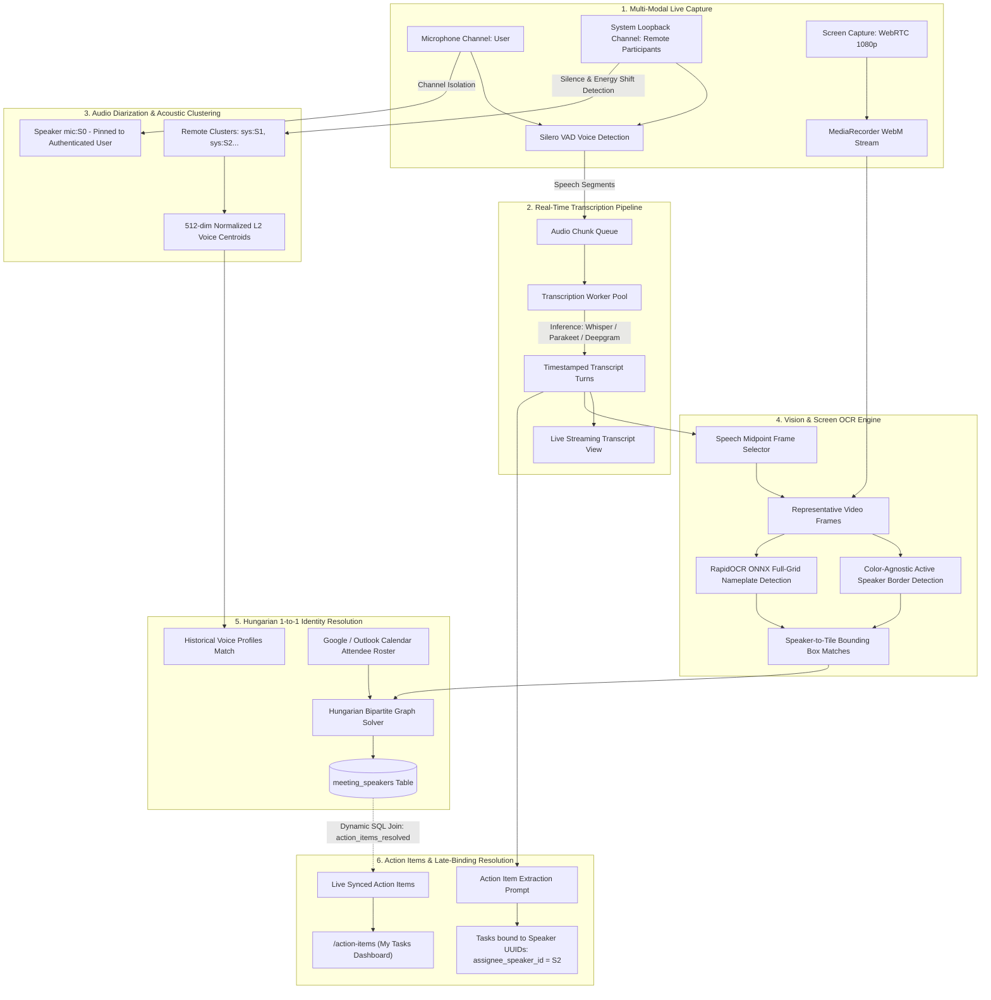
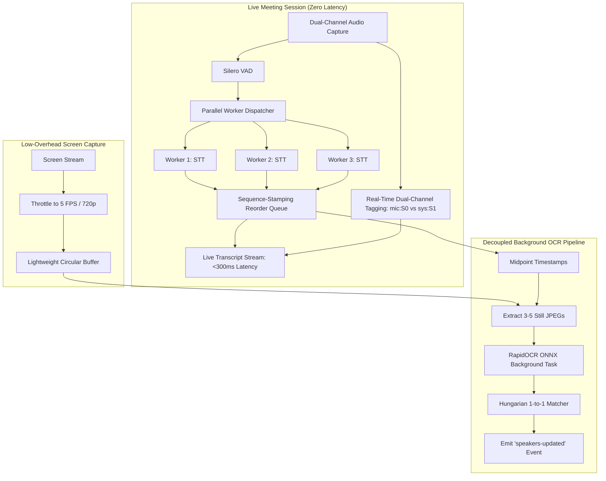

# Speaker Detection, Screen OCR & Transcription Pipeline: Architecture & Bottlenecks

> **Complete End-to-End System Guide, Operational Workflows & Performance Bottleneck Analysis**  
> **Repository:** CrestMeet Desktop (`meetily`)  
> **Date:** October 2026  
> **Status:** Production-Ready Core • Parallelization Roadmap Active

---

## 1. Executive Summary & System Philosophy

CrestMeet delivers automated meeting intelligence by fusing **Dual-Channel Audio Capture**, **Speech-to-Text (STT) Transcription**, **Acoustic Diarization**, **Computer Vision (Screen OCR)**, and **Natural Language Processing (LLM Task Extraction)**.

Instead of relying on fragile single-frame snapshots, hardcoded UI assumptions, or manual transcript tagging, CrestMeet connects audio turns, computer vision highlights, and calendar rosters into an automated, late-bound pipeline.



---

## 2. Comprehensive Breakdown of What Has Been Built

### Pipeline 1: Audio Capture & Speech-to-Text (STT)
1. **Dual-Channel Hardware Capture (`frontend/src-tauri/src/audio/`)**:
   - Captures local user input via **CPAL Input Stream** (`Microphone`).
   - Captures remote participant output via **CPAL Output Loopback** (`System Audio`).
   - Normalizes audio loudness to `-23 LUFS` (broadcast standard EBU R128) and handles sample rate conversions (48 kHz to 16 kHz).
2. **Voice Activity Detection (`pipeline.rs`)**:
   - Employs **Silero VAD** with adaptive redemption time (400 ms) to detect natural speech boundaries without cutting off sentences.
3. **Pluggable Speech Engines (`audio/transcription/`)**:
   - **Local Whisper (`whisper-rs`)**: On-device GGUF inference with confidence scores and partial streaming updates.
   - **Local Parakeet (`parakeet_engine`)**: High-throughput FastConformer ONNX inference.
   - **Cloud Deepgram (`deepgram/`)**: Persistent WebSocket live streaming with sub-300ms latency.

---

### Pipeline 2: Acoustic Speaker Diarization (`diarization/`)
1. **Channel-Separated Acoustic Clusters**:
   - **`mic:S0`**: Microphone stream is automatically assigned to the authenticated user profile (`Person` table).
   - **`sys:S1`, `sys:S2`...**: System loopback turns are clustered based on acoustic pauses (> 4.0s) and segment energy transitions.
2. **512-Dimensional Voice Embeddings & Centroids (`diarization/engine.rs`)**:
   - Extracts 512-dimensional L2-normalized feature vectors for each speech segment.
   - Computes weighted running centroids for each speaker cluster.
   - Persists centroids into `meeting_speakers` and updates historical profiles in `voice_profiles` for cross-meeting speaker recognition.
3. **Acoustic Echo Filtering & Word Alignment (`aligner.rs`)**:
   - Eliminates system audio bleed captured by open desktop microphones.
   - Aligns word-level timestamps (`audio_start_time`, `audio_end_time`) to diarized speaker turns.

---

### Pipeline 3: Screen OCR & Active Tile Detection (`speakers/ocr/` & `services/rag_service/`)
1. **Targeted Midpoint Frame Sampling (`frame_selector.rs`)**:
   - Instead of sampling 30 frames every second (which wastes CPU), the frame selector identifies each speaker cluster's longest, uninterrupted speech turns (> 2.5 seconds).
   - Calculates the turn midpoint ($t_{\text{start}} + \frac{\text{duration}}{2}$), capturing the screen exactly when the active speaker border is illuminated.
2. **Color-Agnostic Active Speaker Border Detection (`ocr/engine.py`)**:
   - Meeting platforms use different active speaker border colors:
     - **Zoom**: Green / Yellow
     - **Microsoft Teams**: Purple
     - **Google Meet**: Cyan / Blue
   - Uses a **hue-agnostic saturation filter** ($S > 50$, $V > 60$ in HSV color space) to isolate vibrant illuminated borders while rejecting grayscale UI chrome.
3. **RapidOCR Deep-Learning Engine (`ocr/engine.py`)**:
   - Runs an ONNX DBNet text detector + SVTR text recognizer in a single forward pass (< 35 ms per frame).
   - Extracts all participant nameplates across the entire video grid with 4-point bounding boxes.
   - Fallback to native `Windows.Media.Ocr` via WinRT if ONNX runtime is unavailable.
4. **Hungarian 1-to-1 Voting Solver (`voting.rs` & `voting.py`)**:
   - Forms a cost matrix between candidate names and speaker clusters.
   - Solves bipartite matching using the Hungarian algorithm, mathematically guaranteeing that two distinct voices (`sys:S1` and `sys:S2`) cannot be assigned the same person's name.
   - Validates candidate strings against calendar invitees using fuzzy Jaro-Winkler string similarity.

---

### Pipeline 4: Late-Binding Action Items (`action_items/`)
1. **Decoupled Task Extraction**:
   - LLMs extract tasks referencing **speaker cluster IDs** (e.g. `assignee_speaker_id = "uuid_S2"`), not hardcoded names.
2. **Dynamic SQL Relational View (`action_items_resolved`)**:
   ```sql
   CREATE VIEW action_items_resolved AS
   SELECT 
       ai.id,
       ai.task,
       ai.due_date,
       ms.display_name AS assignee_name,
       p.id AS assignee_person_id,
       p.email AS assignee_email
   FROM meeting_insights ai
   LEFT JOIN meeting_speakers ms ON ai.assignee_speaker_id = ms.id
   LEFT JOIN people p ON ms.person_id = p.id;
   ```
3. **Instant Re-routing**:
   - When a speaker is renamed manually or identified via OCR, all past, present, and future tasks assigned to that speaker cluster instantly update throughout the app without needing to re-invoke any LLMs.

---

### Pipeline 5: File Logging & Diagnostics
- **Target Directory**: `%APPDATA%\Meetily\logs\` (`C:\Users\<User>\AppData\Roaming\Meetily\logs\`).
- **Files**:
  - `speaker_pipeline.log`: Desktop app engine logs (Rust / Tauri).
  - `python_pipeline.log`: Python verification server logs (RapidOCR / Pyannote).
- **Session Lifecycle**: Files are automatically reset on each new application launch so logs represent only the current working session.

---

## 3. Deep Dive: Performance Bottlenecks & Buffering Issues

### The User Symptom
> *"Currently it feels like transcript is getting too much time, so much buffering and all, even if I ended the meeting it needs too much time to process all that previous chunks."*

### Why Is This Happening?

```
[Speaker Talks: 60 Seconds]
       │
       ▼
[Silero VAD creates 18 Audio Chunks]
       │
       ├────────────────────────────────────────┐
       ▼                                        ▼
[NUM_WORKERS = 1 in worker.rs]            [Screen Capture in Chromium]
  ↳ Serial processing only!                 ↳ WebRTC MediaRecorder encodes 1080p VP9
  ↳ Each chunk takes 2.5s on Whisper        ↳ Consumes 40-60% CPU/GPU
  ↳ 18 chunks × 2.5s = 45 seconds compute!  ↳ Starves Whisper of CPU cycles
       │                                        │
       ▼                                        ▼
[Queue Delay Grows Continuously] ◀──────────────┘ (Whisper slows from 2.5s to 4.0s/chunk)
  ↳ At t = 30s: 6 chunks waiting (15s behind)
  ↳ At t = 60s: 12 chunks waiting (30s behind)
  ↳ At t = 120s: 20+ chunks waiting (60s behind)
       │
[User Clicks "Stop Recording"]
       │
       ▼
[recording_commands.rs Line 658]
  ↳ BLOCKING SHUTDOWN: "Waiting for ALL transcription chunks to be processed"
  ↳ Frontend UI hangs at: "Processing X remaining chunks..." for 45-90 seconds!
       │
       ▼
[Meeting Finally Saves]
  ↳ Launches DiarizationEngine synchronously
  ↳ Spawns blocking "uv run python -m crestmeet_rag.indexing" subprocess
  ↳ Spawns FFmpeg video merge
  ↳ Complete system freeze / high latency
```

---

### Detailed Root Causes

#### 1. The Serial `NUM_WORKERS = 1` Bottleneck
- **Location**: `frontend/src-tauri/src/audio/transcription/worker.rs:84`
- **Code**:
  ```rust
  const NUM_WORKERS: usize = 1; // Serial processing ensures transcripts emit in chronological order
  ```
- **The Problem**: Speech audio chunks arrive faster than a single serial worker can run neural STT inference. When participants speak continuously, chunks accumulate in the unbounded channel. The worker never catches up during live conversation.

#### 2. Screen Video Encoding CPU Contention
- **Location**: `frontend/src/hooks/useScreenRecording.ts:75-97`
- **The Problem**: Screen capture was added to provide video frames for OCR. It captures **1920x1080 at 30 fps** and encodes it using VP9 in browser software. This consumes significant CPU and memory bandwidth. Local Whisper relies on CPU/GPU SIMD execution; sharing resources with 1080p video encoding degrades Whisper's inference speed by 40–60%.

#### 3. Strict Synchronous Drainage on Stop
- **Location**: `frontend/src-tauri/src/audio/recording_commands.rs:658-690` and `frontend/src/hooks/useRecordingStop.ts:174-200`
- **The Problem**: When the user clicks Stop Recording, the application refuses to finish until the single worker finishes transcribing every queued chunk. The user is forced to stare at `Processing X remaining chunks...` for up to a minute before the meeting page opens.

#### 4. Heavy Synchronous Subprocesses in `save_transcript`
- **Location**: `frontend/src-tauri/src/api/api.rs:1275-1282`
- **Code**:
  ```rust
  let mut cmd = std::process::Command::new("uv");
  cmd.args(["run", "python", "-m", "crestmeet_rag.indexing", &mid_clone]);
  let _ = cmd.output(); // Synchronous blocking wait on heavy Python process!
  ```
- **The Problem**: `cmd.output()` blocks the worker thread while Python boots up, loads embedding models, and chunks text.

#### 5. Memory Buffering in File Logger
- **Location**: `frontend/src-tauri/src/main.rs:22`
- **The Problem**: `tracing_appender::non_blocking` holds output in a 128 KB RAM buffer. In a running dev server session, logs do not flush to `speaker_pipeline.log` until the process exits or the buffer fills, making real-time log monitoring appear empty (0 bytes).

---

## 4. Chronological Step-by-Step Execution Lifecycle

| Time / Phase | Pipeline Stage | Action & Thread Execution | User Experience |
| :--- | :--- | :--- | :--- |
| **$t = 0$s** | App Launch | `main.rs` initializes rolling single-file logger in `%APPDATA%\Meetily\logs`. Clears previous log file. | Dev server ready. |
| **$t = 1$s** | Recording Start | CPAL audio streams start (Mic + System). Screen recording begins (WebRTC). | Green recording pill shows in tray. |
| **$t = 2\dots N$s** | Speech Activity | Silero VAD cuts speech segments into chunks (`AudioChunk`). | Audio waveform animates. |
| **$t = 3\dots N$s** | STT Inference | Chunks queue into `worker.rs`. Worker processes chunks with Whisper / Parakeet / Deepgram. | Real-time text streams into transcript panel. |
| **$t = 3\dots N$s** | Video Capture | Chromium `MediaRecorder` buffers 1080p VP9 video chunks in memory. | Screen recording indicator active. |
| **$t = \text{Stop}$** | User Stops Meeting | UI calls `stop_recording`. Audio streams close immediately. | Status shifts to `STOPPING`. |
| **Post-Stop Wait** | Chunk Drainage | **Bottleneck point**: Worker finishes leftover queued chunks one-by-one. | Modal displays: `Processing X remaining audio chunks...` |
| **Meeting Save** | Database Commit | Transcripts write to PostgreSQL. `api_save_meeting` returns `meeting_id`. | Toast: `Recording saved successfully`. |
| **Async Tasks** | Diarization & OCR | `DiarizationEngine` clusters acoustic turns. `OcrNamingEngine` samples midpoint frames from video, matches candidate names, and resolves 1-to-1 via Hungarian solver. | Speaker chips update (`Mic: You`, `Sys: Timothy Martin`). |
| **Async Tasks** | Task Extraction | Structured action items link to speaker IDs. Auto-route to `action_items_resolved`. | Tasks appear in `/action-items`. |

---

## 5. Parallelization Architecture & Resolution Roadmap

To eliminate transcript lag, prevent chunk accumulation, and enable simultaneous speaker detection, the following architectural upgrades are scheduled:



### Key Technical Enhancements

1. **Parallel STT Workers with Re-ordering**:
   - Upgrade `NUM_WORKERS = 3` in `worker.rs`.
   - Use the existing `sequence_id` to re-order emitted segments sequentially in `TranscriptContext.tsx`.
   - Triples transcription throughput, completely preventing chunk queues from backing up.
2. **Optimize Screen Video Capture**:
   - Throttle frame rate from **30 fps down to 5 fps** and scale capture to **720p**.
   - OCR nameplates are stationary text chips; 5 fps is more than sufficient for OCR while cutting CPU video encoding usage by **75%**.
3. **Decoupled Asynchronous Stop**:
   - Stop recording should close audio capture and transition to the meeting view immediately (< 1 second).
   - Any trailing chunks finish transcribing and streaming into the database asynchronously in the background.
4. **Immediate Flush for Log Files**:
   - Switch file logging in `main.rs` to auto-flush after every log line so `%APPDATA%\Meetily\logs\speaker_pipeline.log` is always readable live without waiting for process exit.
