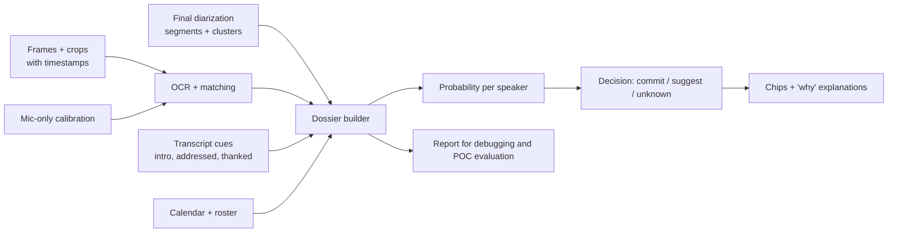

# Single-Frame-per-Segment Evidence Baseline & POC

> Problem: the transcript is a sequence of speaker segments (A, B, C, A, B, ...). Capturing several frames per segment drains a weak CPU, but a speaker who talks only once gets exactly one chance to be named.
>
> This document defines (1) a **frame policy** that takes at most one frame per segment, from different segments, (2) a **probability baseline** for speakers with little evidence, including one-time speakers, (3) an **evidence document** (a per-meeting "dossier") that records and explains every decision, and (4) a **proof of concept (POC)** that tests all of this on real recordings before it is built into the app.
>
> It builds on `ACCURATE_SPEAKER_NAMING_AND_FRAME_CAPTURE_PLAN.md`. **It supersedes that plan's "still A plus stability still B for every turn" rule (trigger E1) and its per-minute budget**, and keeps everything else (native-resolution window stills, adapters, OCR on crops after Stop, guarded assignment, beta controls).

---

## 0. TL;DR

1. **One frame per segment, from different segments.** A frame is captured only for a *clean, long-enough* remote segment. Per speaker, take at most `K` frames (start with 3), each from a different segment at least 60 s apart.
2. **The first eligible segment of every new speaker always gets a frame.** That is the only way to catch a one-time speaker online, because you cannot know a speaker will never talk again.
3. **Decisions use no OCR during the meeting.** The policy is coverage-based (counts and spacing), so live CPU stays tiny. Reading names happens once after Stop.
4. **One frame is made more trustworthy without more frames**, by checks inside the frame, comparison with the neighbouring segments' frames, calibration from the user's own mic, and a lag guard.
5. **One-time speakers get a probability, not a guess.** A single screen observation has a ceiling (the highlight detector's reliability). It is combined with cheap transcript cues ("Priya, what do you think?", "Thanks, Priya", "Hi, this is Priya"), the calendar list and elimination, then labelled **commit**, **suggest** or **unknown**.
6. **The evidence document (dossier) is the baseline.** Every speaker gets a record of segments, frames, observations, cues, ranked candidates with probabilities, the decision, the reasons and the next best action. It drives the UI explanation, debugging and the POC evaluation.
7. **Validate with a POC first**, using offline simulation on gold recordings, so you learn the single-frame reliability and the one-time-speaker accuracy before writing the live capture code.

---

## 1. Definitions

| Term | Meaning |
| :-- | :-- |
| **Segment (turn)** | One continuous stretch of one speaker, from VAD and clustering |
| **Clean segment** | No other speaker active on either channel during the capture moment (and not in the previous 0.5 s) |
| **Eligible segment** | Remote (system channel), clean, and long enough that the active-speaker highlight should already be visible and the speaker is still talking at capture time (starting rule: at least about 1.2 s long) |
| **Frequent / occasional / one-time / too-short speaker** | 4 or more, 2 to 3, exactly 1, or zero eligible segments |
| **Frame** | One native-resolution window capture, kept only as crops (see the earlier plan, 4.2 and 4.7) |
| **Evidence** | Something that raises or lowers the probability that cluster `c` is person `n` |
| **Dossier** | The per-meeting evidence document (section 5) |

---

## 2. Frame policy: one frame per segment

### 2.1 Rules (no OCR needed live)

```text
Settings (starting values):
  K_MAX      = 3     frames per speaker (2 on weak hardware)
  MIN_GAP    = 60 s  between frames of the same speaker (so frames come from different segments)
  DELAY      = 0.9 s after the segment's speech onset (the highlight takes a few hundred ms to appear)
  RATE_LIMIT = 3 frames per rolling minute, F_CAP frames per hour (for example 60)

On remote speech onset of provisional speaker c in segment s:
  schedule a check at onset + DELAY

At the check:
  skip if speech is not still active                      # segment ended: too short
  skip if another speaker was active in the last 0.5 s    # not clean
  skip if CPU busy, any local queue backlogged, rate limit or F_CAP reached
  if frames(c) == 0:                                  capture   # first eligible segment of a new speaker
  elif frames(c) < K_MAX and now - last_frame(c) >= MIN_GAP:   capture   # spread over the meeting
  else skip
```

- **Always capture the first eligible segment of a new speaker.** If that segment is too short, the speaker has no frame yet, so the next eligible segment of the same speaker is treated as "first".
- **Mic-only calibration frames:** take one early (the first time only the mic is active for about 1.5 s) and one later (for example every 5 minutes). The user's tile is the active tile in those frames, which teaches the interpreter what the highlight looks like in this meeting. These are not counted against any remote speaker.
- **Optional early stop:** if live naming is on and a speaker is already committed with high probability, set its frame count to `K_MAX` so it stops being sampled.
- **Optional second frame for new speakers only** (POC switch, off by default): the first eligible segment of a new speaker may get a second frame at about +2.2 s if the speaker is still talking. This costs at most one extra frame per speaker, not per segment.

### 2.2 Worked example: A, B, C, A, B

| Segment | Speaker | Length | Decision | Why |
| :-- | :-- | :-- | :-- | :-- |
| T1 | A | 40 s | **Capture** at onset + 0.9 s | New speaker |
| T2 | B | 25 s | **Capture** | New speaker |
| T3 | C | 6 s | **Capture** (the only chance) | New speaker; long enough to be eligible |
| T4 | A | 30 s | **Capture** if 60 s or more since A's last frame, otherwise skip | Spread rule |
| T5 | B | 20 s | Same rule | Spread rule |
| T6 | A | 10 s | Skip if A already has `K_MAX` frames | Enough coverage |

Expected volume: roughly `K_MAX × number of speakers` frames per meeting, so a 5-person meeting needs about 12 to 18 frames, plus 2 or 3 calibration frames. At a few tens of milliseconds per capture (measure on the i5-7200U), that is negligible next to the 720p recording.

### 2.3 What this policy gives up

- A one-time speaker whose only segment is shorter than the eligibility length gets **no frame**. They are named only from transcript cues, the calendar and elimination (section 4), or left unknown.
- A frequent speaker whose frames all fall in similar conditions (for example all during a screen share) gets correlated, weak evidence. The spacing rule and the "at least 2 time buckets" requirement for committing reduce this risk.

---

## 3. Making one frame more reliable (without more frames)

These checks cost almost nothing, because they reuse frames you already take.

| Check | How it works | Effect |
| :-- | :-- | :-- |
| **Lag guard** | Capture only if speech is still active at capture time, and wait 0.9 s after onset | Avoids frames taken before the highlight appears or after it has moved |
| **In-frame sanity** | Exactly one highlighted tile; the tile has a readable label; label OCR confidence above a floor | Rejects ambiguous frames |
| **Layout cue** | In active-speaker or speaker view, the **largest tile** is normally the speaker. Use size as a second signal next to the highlight. If the app is pinned or spotlighted, the large tile may not be speaking, so lower its weight | Works even when the border is hard to see |
| **Neighbour consistency** | Compare the frame of segment `i` with the frame of segment `i+1` when the speakers differ: if both frames show the **same** highlighted tile, one is wrong or the tile is pinned, so discount both. If they differ, both gain confidence | Free cross-check from frames you already have |
| **Global baseline rate** | A tile highlighted in most frames across several speakers carries no information (pinned or spotlight). Estimate each tile's overall highlight rate and use the lift (see the earlier plan, 5.6) | Neutralizes pinned tiles |
| **Calibration from the user's mic** | Learn colour, thickness and position of the highlight from the mic-only frames | Replaces hardcoded thresholds, so single-frame detection is more reliable |
| **Closed-set check** | Is the label in the calendar list or roster? Is it the user's own name? Is it already claimed by a different speaker with high probability? | Rejects impossible readings, flags conflicts |

The remaining reliability of a single frame is measured in the POC as **α**: the fraction of single-frame highlight readings that name the right person. Everything in section 4 uses α.

---

## 4. Speakers with little evidence (including one-time speakers)

### 4.1 Evidence ladder for a sparse speaker

For a speaker with one segment, combine whatever exists:

| Evidence | Source | Notes |
| :-- | :-- | :-- |
| 1. One frame highlight reading | The one frame | Probability ceiling is α |
| 2. **Self-introduction in the segment** ("Hi, this is Priya", "I'm Priya") | Transcript | Strong, cheap |
| 3. **Addressed by name just before**, then a new speaker answers ("Priya, what do you think?") | Transcript | Medium |
| 4. **Thanked or named just after** ("Thanks, Priya") | Transcript | Medium |
| 5. Calendar attendees and names seen in other frames, minus names already claimed | Calendar, roster | Constrains the candidate set |
| 6. Elimination | Remaining names | **Suggestion only**, and only when the roster is known to be complete |
| 7. Voice profile | Embeddings | Opt-in only |

Run the transcript cues only on the neighbourhood (about 2 segments each side) of sparse speakers, with simple patterns matched against the closed name set. That keeps cost near zero and avoids false hits. An LLM pass over those few segments is optional.

### 4.2 Probability model (simple and auditable)

For each speaker `c`, keep a score per candidate name `n`, where candidates are the calendar names plus names seen on screen, plus an `OTHER` option for guests:

```text
score(c, n) = log prior(n) + sum over evidence i of log LR_i(c, n)
P(c = n)    = softmax of score over all candidates including OTHER
```

- `prior`: uniform over names not already claimed with high probability and not the user. Reserve some probability mass for `OTHER` (more when the calendar list may be incomplete).
- `LR_i`: a likelihood ratio for each evidence type. A frame reading "Priya" with reliability α multiplies Priya's odds by about `α / ((1 - α) / (N - 1))` against the other `N - 1` candidates.
- Cap the combined LR, because evidence types are not fully independent.

**Placeholder values (illustrative, not measured; fit them in the POC):**

| Evidence | Starting LR (for the named person vs another candidate) |
| :-- | :-- |
| Highlight reading, α about 0.8 | Derived from α and the number of candidates |
| Self-introduction | about 10 |
| Addressed just before, then this speaker answers | about 3 |
| Thanked just after | about 4 |

### 4.3 Worked example: a speaker who talks once

Calendar names: Priya, Daniel, Sara, Alex, and the user. Speakers S1 and S2 are already named Daniel and Sara. S3 spoke once. Remaining candidates for S3: Priya, Alex (ignoring `OTHER` for simplicity).

| Step | Evidence | P(Priya) | P(Alex) |
| :-- | :-- | :-- | :-- |
| Prior | Two candidates left | 0.50 | 0.50 |
| + frame highlight reads "Priya" (α = 0.8) | 1 frame | 0.80 | 0.20 |
| + next segment by Daniel: "Thanks, Priya" (LR about 4) | Transcript cue | about 0.94 | about 0.06 |

Decision rule (starting values): **commit** if `P >= 0.90` **and** at least two independent evidence types agree; **suggest** if `P >= 0.50`; otherwise **unknown**. In this example the speaker is committed. With the highlight alone (0.80, one evidence type) it would be a **suggestion** ("Likely Priya, seen on screen once"). With no frame and no cues it stays **unknown**, and the dossier records the next best action.

All numbers above are illustrative. The POC replaces them with measured values.

### 4.4 Rules that keep it honest

- **Single-source evidence never auto-commits** in the beta (except "the mic is the user" and a verified 1:1 shortcut).
- **Conflicts:** two speakers pointing to the same name, or one speaker pointing to two names, produce a merge or split suggestion, not a commit (see the earlier plan, 5.7).
- **Too-short speakers** are shown as unknown with a clear reason, not guessed.
- **UI wording** matches the state: "Priya" with a reason for commits, "Likely Priya (seen on screen once)" for suggestions, `Speaker 3` for unknown.

---

## 5. The evidence document (dossier)

One JSON document per meeting, built after Stop from the frames, the final diarization, the OCR readings and the transcript cues. It is the baseline: **every speaker has an entry even when there is no frame**.



**Schema sketch**

```json
{
  "meeting_id": "m-2026-10-23-001",
  "app": "meet-web",
  "budget": { "frames_taken": 14, "frames_cap": 60, "capture_ms_total": 760, "calibration_frames": 2 },
  "candidates": [
    { "name": "Priya Sharma", "sources": ["calendar", "label_seen"] },
    { "name": "Alex Rivera",  "sources": ["calendar"] }
  ],
  "calibration": { "highlight_profile": "learned_from_mic", "frames_used": 2 },
  "speakers": [
    {
      "cluster": "sys:S3",
      "kind": "one_time",
      "segments": [{ "id": "T118", "start_ms": 842000, "end_ms": 851500, "clean": true, "eligible": true }],
      "frames": [{ "frame_id": "f12", "t_ms": 842900, "segment": "T118", "reason": "first_eligible_segment" }],
      "observations": [{
        "type": "highlight_label",
        "name_raw": "Priya Sh...", "name_norm": "Priya Sharma",
        "ocr_conf": 0.93, "layout": "tiled",
        "checks": { "single_highlight": true, "neighbour_differs": true, "closed_set": true }
      }],
      "text_cues": [{ "type": "thanked_after", "segment": "T119", "text": "Thanks, Priya", "name": "Priya Sharma" }],
      "ranked": [
        { "name": "Priya Sharma", "p": 0.94 },
        { "name": "Alex Rivera",  "p": 0.05 },
        { "name": "OTHER",        "p": 0.01 }
      ],
      "decision": {
        "state": "commit",
        "name": "Priya Sharma",
        "reasons": ["highlight_seen_1x", "thanked_after"],
        "evidence_types": 2
      },
      "next_best_action": null
    },
    {
      "cluster": "sys:S5",
      "kind": "too_short",
      "segments": [{ "id": "T140", "start_ms": 1201000, "end_ms": 1201800, "clean": true, "eligible": false }],
      "frames": [],
      "observations": [],
      "text_cues": [],
      "ranked": [{ "name": "Alex Rivera", "p": 0.45 }, { "name": "OTHER", "p": 0.55 }],
      "decision": { "state": "unknown", "reasons": ["segment_too_short", "no_cues"] },
      "next_best_action": "ask_user_once"
    }
  ],
  "conflicts": []
}
```

**What the dossier is used for**

| Use | How |
| :-- | :-- |
| UI explanation | The "why" text on a name chip comes from `reasons` |
| Beta corrections | A user's accept, reject or rename is stored next to the decision, giving labelled data |
| Debugging | A human-readable report per meeting (timeline of segments, which frames were taken, label crops, readings, probabilities) shows exactly why a name was or was not chosen |
| POC evaluation | The evaluator compares each `decision` with the ground truth |
| Regression tests | Stored crops and cues can be replayed after any threshold or model change |

---

## 6. POC plan

**Goal:** answer, with real recordings, three questions: how reliable is **one** frame (α), how well do one-time speakers get named, and how many frames and how much CPU does the policy use.

### 6.1 Approach: simulate offline on gold recordings

You do not need the live capture code to test the policy.

- Record POC meetings **with a native-resolution screen recording kept only for the POC** (separate from the product's 720p recording), plus both audio channels. The gold video lets the simulator pick **any** timestamp afterwards.
- Run the policy in a **simulator** over the recorded diarization segments: it decides which timestamps would have been captured under the rules in 2.1, then extracts exactly those frames from the gold video.
- Everything after that (crops, OCR, cues, dossier, decisions) is the real pipeline.
- Use your existing Python service (RapidOCR) for the POC to avoid new infrastructure.

### 6.2 Data

| Item | Target |
| :-- | :-- |
| Meetings | 8 to 12 to start, across Google Meet in a browser (most important), Zoom and Teams |
| Sizes | Mix of 2, 4 and 8 or more participants |
| **One-time speakers** | At least 3 meetings where a colleague deliberately speaks once (short and long), and one meeting with a very short interjection |
| Layouts | Tiled or gallery, speaker view, a screen-sharing part, one meeting with a pinned or spotlighted tile |
| Ground truth | For each cluster, the correct name (you label them). The user's own mic frames give free labels for the highlight detector |
| Calendar | For each meeting, the attendee list, including at least one guest who is not on the calendar |

### 6.3 Steps

| Step | Build | Output |
| :-- | :-- | :-- |
| P1 | Policy simulator (section 2.1), frame extraction from the gold video | Frame list per meeting, frames used, spacing |
| P2 | Interpreter baseline: label crops, OCR, name matching, mic-based calibration, sanity checks (section 3) | α per app and layout; highlight accuracy on mic-only frames |
| P3 | Transcript cue extractor (intro, addressed, thanked) for sparse speakers | Cue precision and recall on the labelled meetings |
| P4 | Probability model and decision rules (section 4); dossier builder; HTML or markdown report | A dossier and a readable report per meeting |
| P5 | Evaluator: compare decisions with ground truth; run ablations | Metrics table (6.4) |

### 6.4 Metrics

| Metric | Report separately for |
| :-- | :-- |
| **α**: single-frame highlight reading correct | App, layout, label size |
| Auto-commit precision (committed names that are right) | Frequent, occasional, one-time speakers |
| Coverage: speakers that got a commit or a correct top suggestion | Same split |
| One-time speakers: top-1 suggestion accuracy | With and without text cues; with and without the calendar |
| Frames per meeting and per hour; capture time per frame | Reference laptop |
| Calibration: stated probability versus observed accuracy | Overall |

**Ablations:** `K_MAX` of 1, 2 and 3; with and without the optional second frame for new speakers; with and without neighbour consistency; with and without text cues; with and without the calendar; native-resolution frames versus 720p frames taken from your product recording.

### 6.5 Decision gates

| Gate | Question | If the answer is no |
| :-- | :-- | :-- |
| A | Is α high enough that a single frame plus one more evidence type reaches your commit target for most speakers? | Turn on the optional second frame for new speakers, or improve calibration |
| B | Do one-time speakers get a useful suggestion most of the time? | Make the UI ask the user once for such speakers, and show candidates |
| C | Do frames per hour and capture time fit the low-spec budget? | Reduce `K_MAX`, rate limit, or sample fewer speakers |
| D | Which evidence types add real accuracy? | Remove those that do not, to keep the system small |
| E | Is native resolution clearly better than 720p for labels? | If not, the simpler video-seek path may be enough for some layouts |

**Starting goals (set final numbers from the data):** very few wrong commits, a useful suggestion for most speakers who spoke for a few seconds, and a small, bounded number of frames per meeting.

---

## 7. How this fits the other plans

| Existing item | Change |
| :-- | :-- |
| Naming plan, E1 (two stills per turn) and the per-minute budget | **Replaced** by section 2.1 |
| Naming plan, E2 (turn-change capture) | Covered by "first eligible segment of a new speaker" and the spread rule |
| Naming plan, E3 (mic calibration), E5 (layout probe), E6 (captions) | E3 kept (2.1). E5 dropped; layout is read from the frames you already take. E6 stays opportunistic |
| Naming plan, 5.6 and 5.7 (association scoring, guarded assignment) | Kept; the probability model in 4.2 is the version that works with very few frames |
| Performance plan, 4.G.8 (live naming) | Optional early stop uses it; live OCR is not required for the policy |
| Speaker-identity plan | The dossier is stored with `meeting_speakers`; names still apply by late binding |

---

## 8. Risks and open questions

| Risk | Mitigation |
| :-- | :-- |
| One-time speakers will often remain suggestions or unknown | Say so in the UI; ask the user once; improve with transcript cues and the calendar |
| Provisional live clusters create false "new speaker" frames | Rate limit; eligibility length; cap on new-speaker captures per 10 minutes |
| Naive probability combination overstates confidence | Cap combined LR, require two evidence types to commit, calibrate in the POC |
| The first segment of a speaker falls during a layout change or screen share | The usability gate rejects the frame; the next eligible segment becomes "first" |
| Transcript cues produce false names | Match only against the closed name set; use only near sparse speakers |

**Open questions**

1. Are you willing to accept up to two frames for the *first* eligible segment of a new speaker (never for later segments)? The POC can show whether it is needed; it is off by default.
2. Can you record 8 to 12 POC meetings with a native-resolution gold screen recording, including a few with a deliberate one-time speaker?
3. Should one-time and too-short speakers trigger a single "Who was this?" prompt after the meeting, or stay quiet unless the user opens the speaker list?
