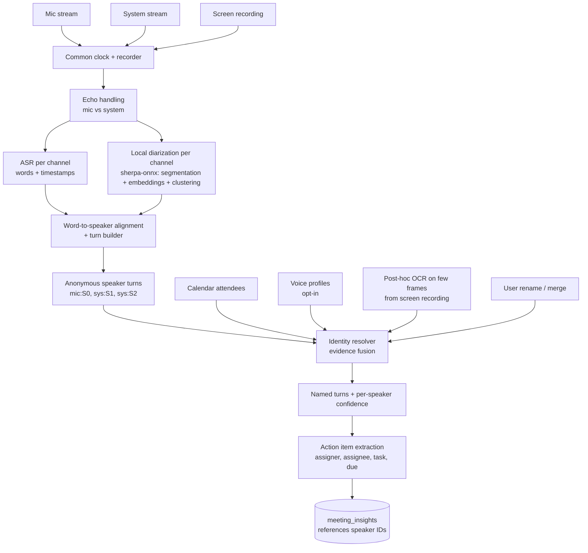
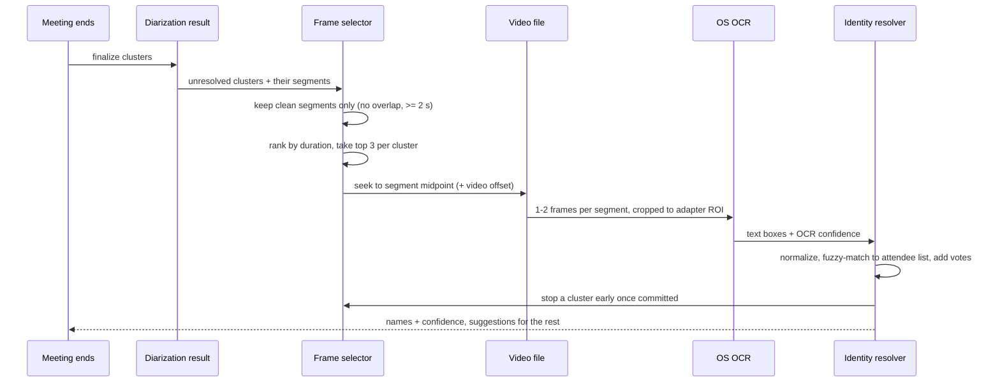
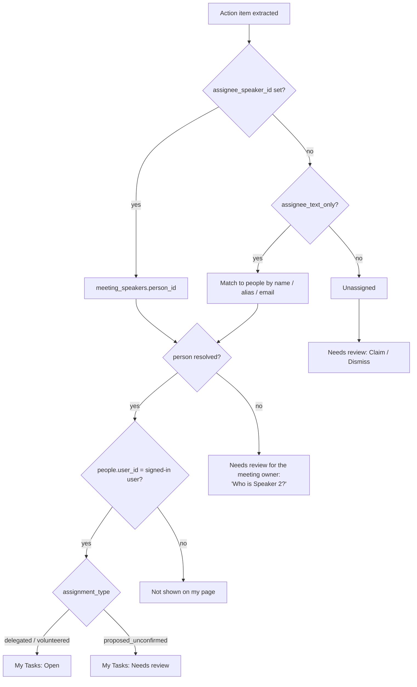

# Speaker Identity & Task Assignment: Lean Implementation Plan

> Goal: for every action item, reliably know **who assigned it**, **to whom**, and **what the task is**, using only mic audio, system audio and the screen recording, without running a vision model on frames.

---

## 0. TL;DR

1. **Audio decides who is speaking. The screen only supplies names.** Diarization (audio) answers "which voice is this". OCR is used afterwards, on a handful of frames, to answer "what is this voice called". They are two separate problems. Diarization runs locally with `sherpa-onnx` (pyannote segmentation + speaker embeddings, section 4.2); the screen is never used to decide who is speaking.
2. **Run OCR post-meeting on the recorded video, not live.** Seek to the timestamps of a few clean speech segments per speaker and read the active-speaker label. Roughly 10 to 30 frames per meeting, no per-frame processing.
3. **Treat every name as evidence with a confidence, never as a fact.** Commit a name only when evidence agrees. Otherwise keep `Speaker 2` and offer a one-click suggestion.
4. **Store speaker IDs, not name strings, on action items.** Renaming or merging a speaker then fixes every assigner and assignee automatically.
5. **Meetily does not solve name resolution automatically** (see section 1). It gives anonymous speaker labels plus a rename/merge UI. The plan below goes one step further, cheaply.
6. **A "My Tasks" page shows each user only the tasks assigned to them** (section 13). It reads from the same speaker-ID-based data, so renaming a speaker moves their tasks onto the right person's page automatically.

---

## 1. How Meetily appears to do it

**What their public pages say** (GitHub README and `meetily.ai/speaker-diarization`):

| Claim | Source status |
| :-- | :-- |
| Diarization is **on-device**, same local pipeline as Whisper/Parakeet transcription | Stated on their site |
| It works **live** and on **imported / re-transcribed** audio | Stated |
| Output is anonymous labels (`Speaker 1`, `Speaker 2`); the user **renames once** and it updates everywhere; **merge** when one person is split in two | Stated |
| **No enrolled voiceprint database** is required | Stated |
| It captures device audio, not a meeting bot, so it is platform-agnostic | Stated |
| Diarization is a **Pro-only** feature (since Pro 1.8.2); the free Community Edition does not include it | Stated |
| Pro is a **different, closed codebase** from the MIT Community app | Stated in README |

**What they do not mention:** any use of screen capture, OCR, or vision to name speakers. Nothing in their docs suggests it.

**What I could not confirm:** the exact diarization model. The repo's topic tags include `sortformer` and `parakeet`, and NVIDIA ships Sortformer (a streaming diarizer) alongside Parakeet, so that pairing is plausible. Because Pro's source is not public, treat that as an educated guess, not a finding.

**Takeaway for you:** the industry-standard baseline is *audio-only diarization + human naming*. That is what you should build first. OCR naming and voice profiles are an optional upgrade that removes most of the manual renaming. Like Meetily, this plan diarizes on-device, but with an open, pyannote-based ONNX pipeline (`sherpa-onnx`) that you control and that also produces speaker embeddings, which power merge suggestions and optional voice profiles (sections 4.2 and 4.6).

---

## 2. Design principles (keeping it lean)

- **No VLM / ViT.** Plain OS-level OCR on a few frames.
- **Local diarization, no new service.** Diarization runs as ONNX models inside the existing Tauri/Rust process through `sherpa-onnx`. The Python RAG service stays untouched. It is independent of your STT provider: it needs only the recorded audio and the word timestamps that STT returns.
- **Batch over live.** The live view shows only a cheap provisional label (`Me` / `Remote`). Accurate speaker separation and naming run once when the meeting ends, in a background thread.
- **Closed-set names.** Calendar attendees and the user's own account bound what a name can be, which makes OCR far more reliable.
- **Every stage degrades gracefully.** If OCR fails, you still have `Speaker N` + rename. If diarization is unsure, the transcript still exists.
- **Data-driven app adapters.** Per-app screen regions live in a JSON config, so supporting a UI change does not need an app release.

---

## 3. Architecture



---

## 4. Stage details

### 4.1 Capture and clock

- Record **mic** and **system** as separate tracks. Never mix them before transcription or diarization. Keep a copy of each track on disk (16 kHz mono is what these models typically expect; verify for the models you pick), because diarization runs on the saved audio when the meeting ends.
- Stamp every audio chunk and the video start with one **monotonic clock** (for example `Instant` at recorder start). Store `video_start_offset_ms` so `audio_time + offset = video_time`. Everything downstream (OCR frame lookup, transcript timestamps) depends on this being right.
- **Echo:** if the user is on speakers, remote voices leak into the mic. Options, in order of preference:
  1. WebRTC AEC with the system stream as the reference signal.
  2. If AEC is too heavy for now: after transcription, drop mic segments whose text and time window overlap a system segment with high text similarity.

### 4.2 Diarization: local `sherpa-onnx` (pyannote-based)

**Decision:** run diarization locally with `sherpa-onnx` (it has Rust bindings). It combines a pyannote segmentation model, a speaker-embedding model and a clustering step, all as ONNX, CPU-capable. No audio leaves the device for this stage, and you get speaker embeddings for free.

**Pipeline:**

| Stage | What it does | Notes |
| :-- | :-- | :-- |
| 1. Segmentation | pyannote segmentation-3.0 (ONNX) finds speech regions and speaker changes in sliding windows | Designed to cope with overlapped speech; check how your `sherpa-onnx` version reports simultaneous speakers |
| 2. Embedding | A speaker-embedding ONNX model turns each segment into a vector | `sherpa-onnx` lists several options (for example 3D-Speaker, WeSpeaker or NeMo-based models). Compare two on your test set |
| 3. Clustering | Groups segments into speakers by cosine distance | Controlled by a distance threshold, or by a fixed speaker count when you are sure of it |
| Output | `(start, end, cluster)` per channel | Plus one embedding per cluster |

**Why this fits:** no fixed speaker cap (NVIDIA Sortformer is limited to 4), open models you can version and test, embeddings available for merge suggestions and voice profiles, and offline processing on the finished recording, which is the most accurate mode and matches the "final at meeting end" design.

**Rust options:** the `sherpa-onnx` crate (the k2-fsa project documents a Rust offline diarization example) or the lighter `pyannote-rs` crate (segmentation-3.0 + WeSpeaker embeddings; it advertises about 1 hour of audio in under a minute on CPU, which you should verify yourself). Default to `sherpa-onnx`, because the same runtime can also run the embedding model for voice profiles (4.6). If time allows, benchmark both on the test set.

**How to apply it:**

- Run diarization **separately per channel**: `mic` clusters are namespaced `mic:S0...`, system clusters `sys:S0...`. Do not merge channels first.
- Default assumption: the single dominant `mic` cluster is the logged-in user. If several people share the user's mic (conference room), the mic channel will produce more than one cluster and the others stay unnamed until resolved.
- Persist one **embedding per cluster** (mean of its clean segments), plus the embedding model ID.
- Parameters to calibrate on your test set: clustering threshold, minimum speech duration, minimum silence between segments (to drop blips and glue fragments). Use the calendar attendee count only as a sanity check (warn if the result differs a lot), never as a hard setting, because guests and dial-ins make it unreliable.
- Run it once when the meeting ends, in a background thread with a progress indicator. The transcript is usable immediately with provisional `Me` / `Remote` labels; speaker clusters and names appear when diarization finishes.
- Ship models in the installer or download them on first use with a checksum. Check each model's **size and license** before you choose it, since the segmentation and embedding models have separate licenses.
- Measure the real-time factor and memory use on your **lowest-spec target laptop** with a 2 to 3 hour recording before committing to this for long meetings.

**Accuracy:** do not promise a number before you measure DER on your own test set (section 7). For direction only, FluidAudio's docs report offline pyannote at about 15% DER versus about 32% for Sortformer on their meeting benchmark, while noting that benchmarks do not always match production.

**Known limits to plan for (measure, do not assume):**

- `sherpa-onnx` diarization works on finished audio (offline), so there are no live per-speaker labels in v1.
- Short interjections ("yeah", "right") are often missed or mislabeled; never use them as naming evidence.
- Similar voices can merge into one cluster; one person can split into two when audio quality changes (for example, compressed conferencing audio).
- Echo of remote voices in the mic track creates extra or wrong clusters, which is why echo handling (4.1) matters.
- Large meetings: tune the threshold on your own recordings with many speakers.

### 4.3 Word-to-speaker alignment (this is what answers "who said this sentence")

1. ASR gives words with start/end times per channel.
2. Diarization gives `(cluster, start, end)` segments per channel.
3. Assign each word to the cluster whose segment overlaps it most. Words in overlapped speech or gaps get the nearest segment but are flagged `low_confidence`.
4. Group consecutive words of the same cluster into a **turn**. Split turns at sentence boundaries when long. Give each turn an ID (`T112`).
5. Drop echo: remove mic turns whose text matches a system turn in the same time window (4.1).
6. Store `speaker_confidence` per turn. Combine: overlap with other speakers (lower is better), turn length (very short turns get less trust), and, optionally, the **embedding margin** (embed the turn audio and compare its distance to its own cluster centroid against the nearest other centroid; a small margin means a doubtful assignment). Calibrate the weights on your test set. Section 5 uses this value.

### 4.4 Identity resolution: the evidence ladder

A cluster's display name comes from the **strongest available evidence**:

| Rank | Evidence | Typical confidence | Notes |
| :-- | :-- | :-- | :-- |
| 1 | **Manual rename** by the user | Locked | Never overwritten automatically |
| 2 | **Channel**: `mic` dominant cluster = account owner | Very high | Free |
| 3 | **Voice profile match** (cosine similarity to stored embedding) | High, calibrate threshold | Opt-in, see 4.6 |
| 4 | **UI Automation / accessibility** "speaking" indicator | High where available | Optional; probe per app |
| 5 | **OCR votes** from the screen recording | Medium to high | Section 4.5 |
| 6 | **Text cues** ("Thanks, Maya", vocative then reply) | Low | Tiebreaker only |

Conflict rules:

- Lower ranks never override higher ranks.
- Enforce **one name per cluster and one cluster per name** (per channel, except the shared-room case). Solve with the Hungarian algorithm over the vote matrix.
- A name may be committed only if `top_score >= T_commit` and `top_score - runner_up >= margin`. Otherwise keep `Speaker N` and attach a **suggested name** that the UI shows for one-click confirm.
- `T_commit` and `margin` are starting values you must **calibrate on your labeled test set** (section 7).

### 4.5 OCR naming: when it triggers, what it reads, how it is accepted

**Key decision: run it after the meeting from the recorded video.** You already have the screen recording, so nothing needs to run during the call. This removes live CPU load and lets you choose the *best* frames instead of whatever frame arrived first.



**Trigger rules (when OCR runs):**

1. Only for clusters that are **still unresolved** after ranks 1 to 3 (manual, channel, voice profile). If voice profiles are enabled, a returning teammate with a stored profile needs zero OCR.
2. Only on **clean evidence segments**: a single speaker, no overlapping speech from another speaker on either channel, a healthy embedding margin (4.3), at least about 2 seconds long, so the frame at the midpoint is safely inside the speech (active-speaker highlights can lag the audio slightly; measure the lag per app and offset accordingly).
3. **Longest segments first**, not chronological. Up to 3 segments per cluster, 1 to 2 frames each.
4. **Early stop** per cluster once it commits.
5. **Hard cap** on frames per meeting (for example 40). If you hit it, leave remaining clusters as suggestions.

Expected cost: about 2 to 6 frames per speaker, so roughly 10 to 30 frames for a typical meeting. Verify the OCR time on your target hardware, but it should be seconds, not minutes.

**What gets read (adapter per app):**

- Detect the meeting app once per recording (process name or window title).
- An adapter is a small JSON entry: where the active-speaker name appears (highlighted tile label, speaker-view caption, or similar), and strings to strip.
- Adapters ship as **data**, so a vendor UI change is a config update.
- Plan for these view modes: speaker view, gallery view, screen-share view (tiles shrink or move). Pick the adapter variant by window layout; if the layout is unknown, **skip the frame** rather than guess.

**OCR engine (no model footprint):**

- Windows: `Windows.Media.Ocr` (built in).
- macOS: Apple Vision text recognition (built in).
- Cross-platform fallback: a small ONNX OCR such as PaddleOCR or the `ocrs` Rust crate.

**Normalization before voting:**

- Strip decorations: `(You)`, `(Guest)`, `Presenting`, `Muted`, role badges, trailing ellipsis.
- Fuzzy-match to the **calendar attendee list** (edit distance or Jaro-Winkler). Accept a match only above a similarity threshold; unmatched strings are kept as `raw_ocr_name` suggestions, not committed names.
- Reject the user's own name for non-mic clusters unless the mic cluster is proven separate.

**Voting:**

```text
observation = (cluster C, name N, q)
q = ocr_confidence × fuzzy_match_score × segment_purity

M[C][N] = sum of q
commit C → N  if  share(N in C) ≥ ~0.7  and  observations ≥ 3  and margin ≥ m
(all three are starting values, calibrate them)
```

`segment_purity` is the turn's `speaker_confidence` from 4.3. Then run the one-to-one assignment so two clusters cannot claim the same person.

**How accurate will it be? An honest answer.**

I cannot give you a trustworthy percentage without testing on your meetings, and any number quoted for "OCR speaker naming" in general would be a guess. What can be said:

- It works best when the meeting app **visibly marks the active speaker** with a readable name in a stable location. In that case, repeated clean observations make wrong names unlikely because errors would have to be consistent across several frames.
- It is weakest with: large gallery grids (small text), screen-share layouts, participants with camera off and only initials, long names truncated by the UI, dial-in users shown as phone numbers, and two people sharing one tile.
- Safety comes from the **acceptance rules**, not the OCR: multiple observations, a vote margin, a closed name set, and one-to-one assignment. When evidence is weak you get an unnamed speaker plus a suggestion instead of a wrong name.
- Measure it (section 7) and set the targets from data. Suggested initial goals to aim for: very few wrong auto-commits (so wrong names are rare), accepting that some clusters stay unnamed.

**Optional upgrade: UI Automation / Accessibility API.** On some desktop meeting clients the "currently speaking" indicator may be readable as text, with no pixels or OCR involved. Reliability varies by app and version, so probe at runtime and treat it as an extra evidence source, not a dependency.

### 4.6 Voice profiles (stop re-solving every meeting)

- Profiles use the **same embedding model as diarization**, so no extra model is needed. Store the `model_id` with each profile: embeddings from different models cannot be compared, so a model change means rebuilding profiles.
- After a cluster is named with high confidence (manual or strong OCR), save its embedding to that person's profile (running mean of clean embeddings).
- In later meetings, match each cluster embedding to stored profiles by cosine similarity, only against attendees in that meeting's calendar event when available (smaller search space, fewer false matches).
- The same person can sound different through the mic than through conferencing audio on the system track. Start by comparing like with like and check on your test set whether cross-channel matching is reliable before relying on it.
- Calibrate the similarity threshold on your data. Prefer to miss a match over making a wrong one.
- This phase is skippable. The rename UI and OCR naming work fully without it.
- **This is biometric data.** Make it **opt-in per person**, stored locally or in your own DB, deletable, and excluded from exports. Meetily explicitly advertises that it needs no voiceprint database; if your customers share that concern, ship with profiles **off by default**.

### 4.7 UI that does the real error correction

Ship these before any OCR work. They fix most remaining errors:

- **Rename speaker** (`Speaker 2 → Maya`): relabels the whole meeting, locks the mapping, optionally saves the profile.
- **Merge speakers**: fixes one person split into two clusters.
- **Split / reassign a turn**: fixes a wrong segment.
- **Suggestion chip**: `Speaker 3 looks like David (seen on screen 4 times)`: Accept / Dismiss.

---

## 5. Action item extraction: assigner, assignee, task

Build this on top of resolved speakers; it is where your original goal gets met.

**Input to the LLM:** turns like

```text
T112 [00:12:15] Alex: We need someone to update the Stripe webhook handler before Friday.
T113 [00:12:22] Maya: I can take that.
T114 [00:12:28] Alex: Great. Maya, make sure tests cover duplicate event IDs.
```

For unresolved speakers use their label, e.g. `Speaker 2 (unnamed)`. **Never let the model invent a name.**

**Two-stage flow (cheap and accurate):**

1. **Candidate detection:** slide a window over turns and flag commitment language (can you, I'll, we need, by Friday, please make sure, will do). A small model or even a regex-plus-LLM-lite pass is enough.
2. **Structured extraction** on each flagged window plus about 10 turns of context each side:

```json
{
  "task": "Update Stripe webhook handler, add duplicate-event tests",
  "assigner_ref": "sys:S1",
  "assignee_ref": "mic:S0",
  "assignee_text_only": null,
  "assignment_type": "volunteered | delegated | proposed_unconfirmed | unassigned",
  "due_phrase": "Thursday afternoon",
  "evidence_turns": ["T112", "T113", "T114"],
  "confidence": 0.9
}
```

**Rules for the hard cases:**

- *"Can you do X?"*: the assignee is the next speaker who accepts. In a 1:1, it is the other person.
- *Acceptance:* `delegated`/`volunteered` only with an acknowledgment; otherwise `proposed_unconfirmed`.
- *"Someone should…", "we need to…"*: `unassigned`. Do not guess.
- *Assignee mentioned but not present in the audio* ("Ask David to review it"): store `assignee_text_only = "David"` and match to attendees by name.
- *Self-assignment:* assigner is null or equal to assignee.
- *Dates:* resolve "Thursday" in **code**, using meeting date and timezone, not in the LLM.

**Validate in code before saving:**

- every `evidence_turn` exists and its speaker matches the claimed assigner/assignee;
- referenced speaker IDs exist in this meeting;
- if the referenced speaker's `name_confidence` is low, save the item but mark `speaker_unresolved = true`, and show it as "Speaker 2 assigned…" until named.

**Late binding is the key trick.** Because items store `assigner_speaker_id` / `assignee_speaker_id` rather than the string "Alex", a later rename or merge updates every item with no re-run of the LLM.

---

## 6. Data model

```sql
-- One row per diarized speaker per meeting
CREATE TABLE meeting_speakers (
  id               UUID PRIMARY KEY DEFAULT gen_random_uuid(),
  meeting_id       TEXT NOT NULL REFERENCES meetings(id) ON DELETE CASCADE,
  cluster_key      TEXT NOT NULL,                 -- 'mic:S0', 'sys:S2'
  channel          TEXT NOT NULL CHECK (channel IN ('mic','system')),
  person_id        UUID,                          -- NULL until resolved
  display_name     TEXT,
  name_source      TEXT CHECK (name_source IN
                   ('manual','channel','voice_profile','ui_automation','ocr','text_cue')),
  name_confidence  REAL,
  suggested_name   TEXT,                          -- shown as a chip when not committed
  embedding        REAL[],                        -- cluster centroid; dimension depends on the embedding model
  embedding_model  TEXT,                          -- model ID used for diarization
  UNIQUE (meeting_id, cluster_key)
);

-- Extend your existing transcript segments table
ALTER TABLE transcript_segments            -- use your actual table name
  ADD COLUMN speaker_id         UUID REFERENCES meeting_speakers(id),
  ADD COLUMN speaker_confidence REAL,                -- derived (4.3)
  ADD COLUMN start_seconds      FLOAT8,
  ADD COLUMN end_seconds        FLOAT8;

-- Opt-in voice profiles
CREATE TABLE voice_profiles (
  person_id   UUID PRIMARY KEY,
  model_id    TEXT NOT NULL,                  -- profiles only compare within the same embedding model
  embedding   REAL[] NOT NULL,
  n_samples   INT NOT NULL DEFAULT 1,
  updated_at  TIMESTAMPTZ NOT NULL DEFAULT NOW()
);

-- Assigner / assignee on action items (builds on your meeting_insights table)
ALTER TABLE meeting_insights
  ADD COLUMN assigner_speaker_id UUID REFERENCES meeting_speakers(id),
  ADD COLUMN assignee_speaker_id UUID REFERENCES meeting_speakers(id),
  ADD COLUMN assignee_text_only  TEXT,
  ADD COLUMN assignment_type     TEXT CHECK (assignment_type IN
                                 ('delegated','volunteered','proposed_unconfirmed','unassigned')),
  ADD COLUMN confidence          REAL,
  ADD COLUMN evidence_turn_ids   TEXT[],
  ADD COLUMN end_seconds         FLOAT8,
  ADD COLUMN speaker_unresolved  BOOLEAN NOT NULL DEFAULT FALSE;
```

Keep your existing `owner_name` as a **derived display column** (or compute it at read time via the join) so current chatbot queries keep working.

The `person_id` columns above point to a `people` table, which is defined in section 13.3 together with the extra columns and the `action_items_resolved` view that the My Tasks page needs.

---

## 7. Accuracy: failure modes and how to measure

| Failure | Effect | Mitigation |
| :-- | :-- | :-- |
| Overlapping speech | Wrong speaker on a few words | Flag low-confidence words; do not use overlapped segments as OCR or profile evidence |
| One person split into 2 clusters | Duplicate speakers | Merge suggestions from embedding similarity + merge button |
| Two people merged into 1 cluster | Wrong attribution | Split/reassign UI; warn on low embedding margin |
| Echo / speakerphone | Duplicate or misattributed text | AEC or text-overlap dedupe (4.1) |
| Wrong OCR name | Wrong assigner/assignee | Vote count + margin + closed name set + one-to-one assignment |
| Same-name attendees ("David A/B") | Ambiguous | Use full display string; fall back to suggestion |
| Many speakers (8+) | Higher diarization error | Tune the clustering threshold on your own large meetings; compare two embedding models |
| Short interjections ("yeah", "right") | Missed or mislabeled | Never use as naming evidence; accept low confidence |
| Poor or compressed remote audio | One person splits into several clusters | Merge UI; tune the threshold per channel |

**Build a small labeled test set before tuning anything:**

- 10 to 20 real meetings across your target apps (Teams / Zoom / Meet), different speaker counts, headphones vs speakers.
- Hand-label who spoke when and who each cluster is. About 20 to 30 minutes of labeling per meeting-hour is realistic.

**Metrics (report per app and per speaker count):**

| Layer | Metric |
| :-- | :-- |
| Diarization | DER (diarization error rate); speaker-count error |
| Word attribution | % of words attributed to the correct speaker |
| Naming | **Auto-commit precision** (of names auto-assigned, how many were right) and coverage (how many clusters got named) |
| Extraction | Precision/recall of action items; correctness of assigner and assignee |

Set thresholds to favor **precision over coverage** for naming. A missing name costs one click; a wrong name quietly corrupts accountability.

---

## 8. Resource budget

- Diarization: two ONNX models (pyannote segmentation + speaker embedding), CPU-capable, run once at meeting end in a background thread. Check model sizes against your installer budget, and measure real-time factor and memory on your lowest-spec target laptop with a 2 to 3 hour recording.
- OCR: OS-provided on both platforms, so no added model download.
- Frame extraction: seeks into the existing recording at a few timestamps. If your recorder cannot seek cheaply, record screen at about 1 fps with no inference attached, which is cheap.
- No GPU requirement, no extra server process, no per-frame inference.

---

## 9. Rollout phases and exit criteria

| Phase | Build | Exit criteria |
| :-- | :-- | :-- |
| **0. Baseline** | Labeled test set + metrics harness | Current system measured |
| **1. Channels + diarization** | Separate mic/system, echo handling, `sherpa-onnx` diarization per channel, word alignment, turn IDs, turn confidence | Per-word attribution and DER measured on the test set; real-time factor measured on low-end hardware |
| **2. Naming UI** | `meeting_speakers` table, rename / merge / reassign, calendar attendee list as name picker | A user can fix a meeting in under a minute |
| **3. Assignment extraction** | Two-stage extraction, validation, schema migration, late-binding references | Assigner and assignee correct on the test set at your target rate |
| **3b. My Tasks page** | `people` table, `action_items_resolved` view, Tauri commands, My Tasks route (section 13) | Renaming a speaker moves their tasks onto that person's page without re-extraction; status changes survive re-processing |
| **4. OCR naming** | Frame selector, app adapters, voting, one-to-one assignment, suggestion chips | Auto-commit precision meets target; wrong-name rate low |
| **5. Voice profiles (opt-in)** | Profile store (same embedding model as diarization), match, consent and delete flows | Repeat-attendee clusters named with no OCR |
| **6. Optional** | UI Automation signal; live per-speaker labels (chunked incremental diarization, or Sortformer for up to 4 speakers) | Only if live labels are a real requirement |

Phases 1 to 3 already deliver your ultimate goal (action items with assigner and assignee), and phase 3b is where users actually see it. Phases 4 and 5 reduce manual renaming. Frontend work for 3b can start in parallel with phase 3 using the interim matching described in section 13.2.

---

## 10. Privacy and compliance notes

- Diarization is fully local: audio, video frames and embeddings stay on the user's device or your own database. Whether STT sends audio to a third party depends on the STT provider you use.
- Voice embeddings are biometric identifiers in several jurisdictions. Make profiles opt-in, document retention, and provide delete-my-voice.
- OCR frames are temporary: extract, read, discard. Store only the resulting name evidence (name string, timestamp, confidence), not the frames.
- If any stage (STT, summarization) uses a cloud provider, state clearly in the UI which audio or text leaves the device.

---

## 11. Deliberately not building

- Per-frame vision models or face recognition (cost, privacy, and unnecessary: names come from text and audio).
- Live OCR during the call.
- A separate Python diarization service.
- A cloud dependency for speaker labels. Diarization stays local; revisit only if the local pipeline misses your accuracy targets on the test set.
- Auto-renaming that overrides manual edits.
- Any claim of "who said it" without a stored confidence.
- A full project-management tool. The My Tasks page is a personal to-do list: no kanban boards, subtasks, comments or team dashboards in the first version.

---

## 12. Open questions to settle early

1. Which apps dominate your users (Teams, Zoom, Meet) and do they usually wear headphones? This sets adapter priority and how much echo handling matters.
2. Is live per-speaker labeling a hard requirement, or is "labeled when the meeting ends" acceptable? `sherpa-onnx` diarization is offline, so live labels need extra work; if acceptable, skip them in v1.
3. Can the recorder seek by timestamp, or should it also write a 1 fps frame track?
4. Are voice profiles acceptable for your customers (consent and regional law)?
5. Is the app single-user or team-based? This decides whether a person can see tasks from meetings recorded by a colleague (section 13.7 covers the access rules).
6. Should completing a task on the My Tasks page sync to an external tool (Jira, Asana, a calendar), or stay inside the app for the first version?
7. Which STT provider will you use going forward, and does it return word-level timestamps per channel? Diarization needs only those timestamps; it does not depend on any provider's own diarization feature.
8. What is the lowest-spec laptop you must support? This sets the acceptable diarization time and which embedding model you can afford.

---

## 13. "My Tasks" page (Action Items panel)

One page where a signed-in user sees every task assigned to them, across all their meetings. It is the user-facing payoff of the whole pipeline.

### 13.1 Scope

| MVP (build first) | Phase 2 (after MVP works) | Not in scope |
| :-- | :-- | :-- |
| "Assigned to me" list with status, due date, assigner, meeting | "Assigned by me" tab (tasks I delegated) | Kanban boards, subtasks, comments |
| Tabs: Open, Needs review, Done | Due-today / overdue reminders | Team dashboards |
| Mark done / in progress / dropped, edit due date and text | Sidebar badge with open + overdue count | Sync to Jira / Asana (see open question 6) |
| Evidence drawer: transcript quote, timestamp, play audio from there | "Similar to a task from another meeting" hint for recurring tasks | |
| Review actions: Confirm, Not mine, Claim, "Who is Speaker N?" | | |

### 13.2 How a task ends up on *my* page



| Situation | Where it appears |
| :-- | :-- |
| Assignee resolves to me, and they accepted (delegated / volunteered) | **Open** |
| Assignee resolves to me, but only proposed and never acknowledged | **Needs review**: Confirm / Not mine |
| Assignee is an unnamed speaker (`Speaker 2`) in a meeting I recorded | **Needs review**: "Who is Speaker 2?" opens the rename dialog; once named, items move on their own |
| Assignee is someone else | Not on my page (appears under "Assigned by me" if I was the assigner) |
| Nobody was assigned ("someone should…") | **Needs review**: Claim / Dismiss |

**Who is "me":** the signed-in user has one `people` row linked by `user_id`. The dominant mic cluster is auto-linked to that row (evidence rank 2 in section 4.4), so "I'll take that" items resolve to the user without any OCR or voice profile.

**Interim matching, so the frontend can start before speaker IDs exist:** until phase 2 and 3 land, match the existing `owner_name` text against the user's `display_name` and `aliases`. Treat these matches as lower confidence and show them in Needs review, not Open.

### 13.3 Data model additions

```sql
-- Real-world people. user_id is set only for people who have an app account.
CREATE TABLE people (
  id           UUID PRIMARY KEY DEFAULT gen_random_uuid(),
  user_id      UUID UNIQUE,                       -- NULL for external attendees
  display_name TEXT NOT NULL,
  email        TEXT,
  aliases      TEXT[] NOT NULL DEFAULT '{}'       -- 'Dave', 'David A.'; used for text-only matches
);

ALTER TABLE meeting_speakers
  ADD CONSTRAINT fk_meeting_speakers_person FOREIGN KEY (person_id) REFERENCES people(id);
ALTER TABLE voice_profiles
  ADD CONSTRAINT fk_voice_profiles_person FOREIGN KEY (person_id) REFERENCES people(id);

-- Extra columns for the page (on top of the section 6 migration)
ALTER TABLE meeting_insights
  ADD COLUMN assignee_person_id UUID REFERENCES people(id),  -- for assignees named in text only
  ADD COLUMN due_phrase         TEXT,                        -- original wording, e.g. 'Thursday afternoon'
  ADD COLUMN completed_at       TIMESTAMPTZ,
  ADD COLUMN updated_at         TIMESTAMPTZ NOT NULL DEFAULT NOW(),
  ADD COLUMN user_edited        BOOLEAN NOT NULL DEFAULT FALSE,
  ADD COLUMN dedupe_key         TEXT;                        -- hash(meeting_id + evidence_turn_ids)

CREATE UNIQUE INDEX uq_action_item_dedupe
  ON meeting_insights (meeting_id, dedupe_key) WHERE type = 'action_item';
CREATE INDEX ix_insights_status_due ON meeting_insights (type, status, due_date);
CREATE INDEX ix_speakers_person     ON meeting_speakers (person_id);
```

**Late-bound read view.** Names and owners are resolved when the page reads, so renames and merges apply instantly:

```sql
-- Sketch: adapt table and column names to your schema.
CREATE VIEW action_items_resolved AS
SELECT mi.id, mi.meeting_id,
       m.title AS meeting_title, m.created_at AS meeting_date,
       mi.content AS task, mi.due_date, mi.due_phrase,
       mi.status, mi.assignment_type, mi.confidence,
       mi.start_seconds, mi.end_seconds, mi.evidence_turn_ids,
       mi.completed_at, mi.updated_at,
       mi.assignee_speaker_id, mi.assigner_speaker_id,
       ae_p.id      AS assignee_person_id_resolved,
       ae_p.user_id AS assignee_user_id,
       COALESCE(ae_p.display_name, ae.display_name, mi.assignee_text_only, ae.cluster_key) AS assignee_label,
       ar_p.user_id AS assigner_user_id,
       COALESCE(ar_p.display_name, ar.display_name, ar.cluster_key)                        AS assigner_label
FROM meeting_insights mi
JOIN meetings m                 ON m.id = mi.meeting_id
LEFT JOIN meeting_speakers ae   ON ae.id = mi.assignee_speaker_id
LEFT JOIN meeting_speakers ar   ON ar.id = mi.assigner_speaker_id
LEFT JOIN people ae_p           ON ae_p.id = COALESCE(ae.person_id, mi.assignee_person_id)
LEFT JOIN people ar_p           ON ar_p.id = ar.person_id
WHERE mi.type = 'action_item';
```

The UI turns an unresolved `cluster_key` such as `sys:S2` into the label "Speaker 2".

**Page queries:**

```sql
-- Open tab
SELECT * FROM action_items_resolved
WHERE assignee_user_id = $1
  AND status IN ('open','in_progress')
  AND assignment_type IN ('delegated','volunteered')
ORDER BY (due_date IS NULL), due_date, meeting_date DESC
LIMIT 50;

-- Needs review tab (mine-but-unconfirmed, unnamed-speaker items in my meetings, unassigned)
SELECT r.* FROM action_items_resolved r
JOIN meetings m ON m.id = r.meeting_id
WHERE r.status = 'open' AND (
      (r.assignee_user_id = $1 AND r.assignment_type = 'proposed_unconfirmed')
   OR (m.user_id = $1 AND r.assignee_user_id IS NULL
       AND r.assignment_type IN ('delegated','volunteered','unassigned'))
);
```

If the desktop app reads from local SQLite rather than Postgres, express the same joins as a query in `queries.rs` instead of a view.

### 13.4 Backend: Tauri commands

Follow your existing `api_` naming. Suggested location: `frontend/src-tauri/src/action_items/` (`mod.rs`, `queries.rs`, `commands.rs`).

| Command | Purpose |
| :-- | :-- |
| `api_list_my_action_items(filters, cursor)` | Open / Done tabs, filters, cursor pagination (50 per page), returns tab counts |
| `api_list_action_items_needing_review()` | Needs review tab |
| `api_update_action_item(id, patch)` | Change `status`, `due_date`, `content`. Sets `user_edited = true`, `updated_at`; sets or clears `completed_at` |
| `api_confirm_action_item(id)` | Promote `proposed_unconfirmed` to `delegated` |
| `api_reject_action_item(id)` | "Not mine": set `status = 'dropped'` |
| `api_claim_action_item(id)` | For unassigned or unnamed items: set `assignee_person_id` to my person, `assignment_type = 'volunteered'` |
| `api_get_action_item_evidence(id)` | Evidence turns (speaker, text, time) for the drawer, plus the audio offset |

**Event:** emit `action-items-updated` after extraction finishes and after any speaker rename or merge. The page listens and refetches, so no polling is needed.

**Writer rules (in the phase 3 extraction code):**

- Upsert by `(meeting_id, dedupe_key)`. Re-processing a meeting must not create duplicates.
- Never overwrite items where `user_edited = true` or `status` is not `open`.
- Resolve `assignee_text_only` to a `people` row by name, alias or email at write time; store the match in `assignee_person_id`. Keep the raw text either way.
- Resolve due dates in code (meeting date and timezone) and store `due_phrase` alongside.

### 13.5 Frontend: page and components

Paths assume a Next.js app router under `frontend/src/`; adjust to your layout.

```text
app/action-items/page.tsx            route + tab state
components/action-items/
  TaskList.tsx                       grouped list, empty/loading/error states
  TaskCard.tsx                       one task
  TaskFilters.tsx                    search, due bucket, meeting, assigned-by
  ReviewCard.tsx                     Confirm / Not mine / Claim / Who is Speaker N?
  TaskDrawer.tsx                     evidence, edit, play audio
hooks/useMyActionItems.ts            invoke() + event subscription + optimistic updates
```

**Layout:**

- Header "My Tasks" with counts. Tabs: **Open · Needs review (n) · Done**.
- Default grouping by due date: Overdue, Today, This week, Later, No date. Overdue is computed in the user's local timezone.
- Add a nav entry (sidebar) for the page; Phase 2 adds the open + overdue badge.

**Task card shows:** checkbox to complete, task text, due chip (resolved date, tooltip with the original phrase), "from Alex" (assigner), meeting title and date (links to the meeting), small badge for `volunteered` / `delegated`, and a low-confidence marker when `confidence` or `speaker_unresolved` says so.

**Drawer shows:** the evidence turns with speaker names and timestamps, a **Play from 12:15** button, editable task and due date, **Open meeting**, and a **Wrong person? Fix speaker name** link into the rename dialog from section 4.7.

**Behavior:** status changes are optimistic with rollback on error; the list refetches on the `action-items-updated` event; Needs review is visually separate so uncertain items never look like confirmed commitments.

### 13.6 Edge cases

| Case | Handling |
| :-- | :-- |
| User renames or merges a speaker | View resolves it at read time; event triggers a refetch; items move to the right person's page |
| Meeting re-processed or re-transcribed | Upsert by `dedupe_key`; edited or completed items are preserved |
| Two people with the same first name | Match on full display string or email; if ambiguous, send to Needs review |
| Task with no due date | Shown under "No date" |
| Recurring task mentioned in several meetings | MVP shows each; Phase 2 adds a "similar to…" hint using the existing embedding, never auto-merges |
| Assignee named in text but not in the call | Matched through `people.aliases` / email; unmatched stays as text and goes to Needs review for the meeting owner |
| Item shows up under the wrong person | "Wrong person?" link goes to rename/reassign; fixing the speaker fixes all of that speaker's items |

### 13.7 Access control

- Default: a person sees items where they are the **assignee**, plus Needs review items for meetings they **recorded**. They see items where they are the **assigner** in the Phase 2 "Assigned by me" tab.
- Never show other people's tasks on the My Tasks page.
- If you have a team backend, enforce this in the database (row-level security) and not only in the UI. Allow edits to `status`, `due_date` and `content` only for the assignee or the meeting owner.
- Cross-user visibility (a colleague recorded the meeting, I was assigned a task) requires shared meetings within a project; that depends on open question 5.

### 13.8 Development tasks

| ID | Task | Area | Depends on | Done when |
| :-- | :-- | :-- | :-- | :-- |
| T1 | Create `people`; link the signed-in user; auto-link the mic cluster to the user's person | DB, Rust | Phase 2 (`meeting_speakers`) | Every new meeting has the user's mic cluster mapped to the user's person |
| T2 | Migration for new `meeting_insights` columns, dedupe key and indexes | DB | Phase 3 schema | Migration applies cleanly on a copy of real data |
| T3 | `action_items_resolved` view and access rules | DB | T1, T2 | Renaming a speaker in a test meeting changes `assignee_user_id` in the view with no other writes |
| T4 | Extraction writer: upsert, alias resolution of text-only assignees, `due_phrase`, preserve user edits | Rust | T2, Phase 3 | Re-processing a meeting creates no duplicates and keeps edited and completed items |
| T5 | Rust queries and the Tauri commands in 13.4 | Rust | T3 | Each command has a test against a fixture database |
| T6 | Emit `action-items-updated` on extraction finish and on speaker rename / merge | Rust | T5 | Event fires in both cases |
| T7 | Route, nav entry and `useMyActionItems` hook | Frontend | T5 | Page loads real data for the signed-in user |
| T8 | `TaskList`, `TaskCard`, filters and due-date grouping | Frontend | T7 | Grouping and filters correct for overdue, today, week, later, no date |
| T9 | Needs review tab: Confirm, Not mine, Claim, "Who is Speaker N?" flow into the rename dialog | Frontend | T7, section 4.7 UI | Naming a speaker moves its items without a manual refresh |
| T10 | `TaskDrawer` with evidence turns and audio seek | Frontend | T5 | Play from timestamp lands within the evidence segment |
| T11 | Tests: view tests (rename and merge moves items), command tests, UI tests (complete, filter), one end-to-end test using a fixture meeting | QA | T3 to T10 | Run in CI |
| T12 | Phase 2: "Assigned by me" tab, due reminders, sidebar badge, similar-task hint | All | MVP done | Behind a flag until stable |

**Page-level acceptance criteria:**

1. Renaming `Speaker 2` to the signed-in user moves that speaker's tasks onto My Tasks without re-extraction or a manual reload.
2. A task marked done stays done after the meeting is re-processed.
3. The page never lists a task assigned to someone else.
4. Every task opens to its transcript evidence with a working "play from" action.
5. Items that rest on weak evidence (unconfirmed, unnamed speaker, unassigned) appear only under Needs review.

---

## References

- Meetily GitHub README and `meetily.ai/speaker-diarization` (diarization is on-device, Pro-only, rename/merge, no enrolled voiceprint database)
- FluidAudio docs: Sortformer vs pyannote comparison (4 fixed slots; offline pyannote reported at lower DER on their benchmark)
- NVIDIA NGC: Parakeet + Sortformer collections (Sortformer supports up to 4 speakers)
- `sherpa-onnx` speaker diarization docs (pyannote segmentation 3.0 + embedding extractors + clustering, Rust API)
- `pyannote-rs` crate (segmentation-3.0 + WeSpeaker embeddings with cosine similarity, ONNX)
