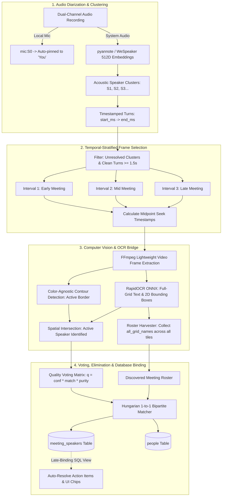

# Multimodal Speaker Diarization, Temporal OCR & Dynamic Roster Pipeline

> **Document Type:** Architecture Specification & Engineering Strategy  
> **Status:** Proposal & Implementation Roadmap  
> **Target Audience:** Engineering, Product, AI/ML Team

---

## 1. Executive Summary & Core Aim

In automated meeting intelligence, answering **"Who is speaking?"** and **"Who owns which action item?"** is typically bottle-necked by either:
1. **Audio-only limitations:** Diarization models can cluster voices (`Speaker 1`, `Speaker 2`), but have no idea what those humans are called.
2. **Brute-force vision overhead:** Running continuous video OCR at 30 FPS across a 1-hour meeting consumes massive CPU/GPU resources and is completely impractical on client devices.

### The Core Motive & Philosophy
This pipeline implements a **decoupled multimodal architecture**:
* **Audio Diarization answers *WHEN* and *WHO*:** Extracts 512-dimensional voice embeddings from audio channels and clusters them into acoustic identities (`mic:S0`, `sys:S1`, `sys:S2`...).
* **Vision & RapidOCR answers *WHAT TO NAME THEM*:** Seeks directly to a handful (3–5) of strategically spaced, clean video frames to read participant nameplates.

### Key New Innovations in This Plan
1. **Temporal-Stratified Frame Selection:** Instead of greedily sampling the longest speech segments (which often cluster in the first 2 minutes during introductions), we sample across **multiple distinct segments across the entire meeting timeline** (Early, Mid, Late) plus intra-segment verification.
2. **Opportunistic Full-Grid Roster Harvesting:** Every sampled frame contains the *entire meeting grid* (4–16 tiles). While inspecting the active speaker, RapidOCR reads every other visible tile in the background, building a **complete, verified meeting attendee roster** without additional compute.
3. **Hungarian 1-to-1 Bipartite Elimination:** Even if quiet speakers never trigger an active speaker border, they are reliably identified by eliminating already-claimed names from the harvested grid roster.

---

## 2. Technical Complications & Real-World Edge Cases

In real-world meeting recordings (Zoom, Microsoft Teams, Google Meet), visual identification faces significant challenges:

| Real-World Challenge | Failure Mode in Naive Pipelines | How Our Architecture Solves It |
| :--- | :--- | :--- |
| **Screen Sharing / Presentations** | Slides take over 95% of the screen. Participant tiles shrink or disappear. | **Temporal Stratification**: If the first 15 minutes were slides, samples from the middle (Q&A) and end of the meeting will catch normal grid views. |
| **Camera & Video Toggles** | A user turns their camera off or on mid-call, changing layout or replacing video with static initials. | **Multi-Segment Sampling**: Sampling turns at minutes 1, 5, 20, and 35 ensures we observe the participant under multiple visual states. |
| **Grid Layout Shifts** | Pinning participants, switching between Gallery View and Speaker View. | **Full-Grid Nameplate Scanning**: RapidOCR captures all bounding boxes regardless of grid position, rather than assuming fixed coordinate anchors. |
| **Quiet / Soft Speakers** | Short speech bursts (< 1s) fail to trigger the meeting app's glowing active-speaker border. | **Harvested Roster Elimination**: The person’s nameplate is visible in the background grid of *other* speakers' frames. By elimination, their voice cluster matches their tile. |
| **Single-Frame Visual Glitches** | Temporary network drops, webcam blur, or person looking away. | **Multi-Observation Voting**: Requires multiple consistent frame observations with confidence thresholding before committing a name. |
| **Audio/Video Timing Drift** | Recorder initialization skew causes audio timestamps to misalign with video frames. | **Speech Midpoint Alignment**: We sample at the mathematical midpoint of clean turns ($\text{start} + \frac{\text{duration}}{2}$), safely buffered away from boundary lag. |
| **UI Chrome Noise** | Badges like `(You)`, `(Guest)`, `(Host)`, `Muted`, `Presenting`. | **Token Stripping & Fuzzy Normalization**: Pre-cleans platform tokens before Jaro-Winkler attendee matching. |

---

## 3. High-Level Architectural Flow



---

## 4. Deep-Dive: The Core Mechanisms

### A. Temporal-Stratified Frame Selection

#### The Problem with Naive Duration Sorting
If Speaker A gave a 2-minute introductory monologue at minute 1, a naive duration sort takes all 3 frames from minute 1:
```
[Minute 0 ─── Minute 1 ─── Minute 2 ────────────────────────────────────────── Minute 45]
              ▲   ▲   ▲
         All 3 frames clustered in first 2 minutes (High Risk: Screen share / intro slides)
```

#### The Stratified Algorithm
We divide the meeting into $K$ temporal strata (default $K=3$: Early, Mid, Late) and enforce a minimum time gap ($\Delta t \ge 60\text{s}$):

```
Meeting Timeline: 0 to 45 mins
├────────────── Early (0-15m) ─────────────┼────────────── Mid (15-30m) ─────────────┼────────────── Late (30-45m) ─────────────┤
              ▲                                          ▲                                          ▲
   Segment at min 1.5 (Intro)                 Segment at min 22.0 (Discussion)           Segment at min 39.0 (Closing)
```

1. **Chronological Binning:** All speech turns for cluster $S_i$ are partitioned into time buckets based on their `start_seconds`.
2. **Purity Filter:** Segments shorter than 1.5s or flagged with overlapping crosstalk are rejected.
3. **Best-in-Bucket Selection:** The longest, cleanest segment in each time bucket is selected.
4. **Speech Midpoint Calculation:**
   $$\text{seek\_seconds} = \text{segment\_start} + \frac{\text{segment\_duration}}{2} + \text{video\_start\_offset}$$
   *Why Midpoint?* Video conferencing platforms require ~200–400ms to illuminate an active-speaker border after speech starts. At the exact middle of an uninterrupted 3-second segment, the visual border is guaranteed to be steady and bright.
5. **Multi-Frame Intra-Segment Verification (Optional Micro-Step):** For very long turns (> 5s), two frames separated by 1.5 seconds can be verified to prove the nameplate remains identical.

---

### B. Opportunistic Full-Grid Roster Harvesting

When an image frame is extracted to find the active speaker, that frame contains **all participants in the meeting**:

```
┌─────────────────────────────────────────────────────────────────┐
│  Full Screen Frame (1920x1080)                                  │
│                                                                 │
│  ┌────────────────────────┐         ┌────────────────────────┐  │
│  │ Tile 1 (Inactive)      │         │ Tile 2 (ACTIVE SPEAKER)│  │
│  │                        │         │   [PURPLE/GREEN BORDER]│  │
│  │                        │         │                        │  │
│  │ Name: [Daniel Craig]   │         │ Name: [Timothy Martin] │  │
│  └────────────────────────┘         └────────────────────────┘  │
│                                                                 │
│  ┌────────────────────────┐         ┌────────────────────────┐  │
│  │ Tile 3 (Inactive)      │         │ Tile 4 (Inactive)      │  │
│  │                        │         │                        │  │
│  │ Name: [Sarah Connor]   │         │ Name: [Alex Rivera]    │  │
│  └────────────────────────┘         └────────────────────────┘  │
└─────────────────────────────────────────────────────────────────┘
```

#### How It Works:
1. **Primary Target (Active Speaker):**
   - The vision module finds the illuminated border ($S > 50$ in HSV).
   - Spatial intersection links Tile 2's nameplate (`Timothy Martin`) to the active cluster $S_1$.
2. **Secondary Target (Grid Harvester):**
   - RapidOCR simultaneously reads the nameplates in Tile 1, Tile 3, and Tile 4.
   - The engine extracts:
     $$\text{all\_grid\_names} = [\text{"Daniel Craig"}, \text{"Timothy Martin"}, \text{"Sarah Connor"}, \text{"Alex Rivera"}]$$
3. **Cumulative Roster Building:**
   - Over 6–10 sampled frames, the system builds a deduplicated, high-confidence **Discovered Meeting Roster**.
4. **Solving Quiet Speakers via Elimination:**
   - If Speaker 2 only spoke 3 words and never had an active glowing tile, but Speaker 1, 3, and 4 are firmly identified as Timothy, Daniel, and Sarah, the Hungarian matching algorithm links Speaker 2 to **Alex Rivera** by elimination.

---

### C. Active Speaker Tile Detection (Color-Agnostic)

Different meeting platforms use different highlight border colors:
* **Zoom:** Green / Yellow
* **Microsoft Teams:** Purple
* **Google Meet:** Blue / Cyan
* **Webex:** Blue

Rather than hardcoding RGB thresholds, the vision engine uses a **Hue-Agnostic Saturation & Edge Filter**:
1. Neutral UI chrome (black video backgrounds, gray taskbars, dark tiles) has very low color saturation:
   $$S < 35 \implies \text{Background/Neutral (Discard)}$$
2. Active speaker highlight borders have vibrant chroma:
   $$S \ge 50 \implies \text{Active Highlight Candidate}$$
3. Morphological contour analysis identifies rectangular perimeter rings.
4. If a candidate rectangle matches standard tile aspect ratios (16:9, 4:3), it is declared the **Active Speaker Tile**.

---

### D. Quality Scoring & Voting Matrix

To avoid misidentifying people due to occlusions or camera blinks, each frame observation generates a weighted vote:

$$q = \text{ocr\_confidence} \times \text{fuzzy\_similarity} \times \text{segment\_purity}$$

* **$\text{ocr\_confidence}$ ($0.0 - 1.0$):** RapidOCR character recognition score.
* **$\text{fuzzy\_similarity}$ ($0.0 - 1.0$):** Jaro-Winkler match against calendar attendees or discovered roster.
* **$\text{segment\_purity}$ ($0.0 - 1.0$):** Absence of overlapping crosstalk during that turn.

#### Acceptance Rules:
* **Auto-Commit Threshold ($q \ge 0.75$, $\text{votes} \ge 2$, $\text{margin} \ge 0.20$):** The system automatically writes the name as verified (`name_source = 'ocr'`).
* **Suggestion Threshold ($0.50 \le q < 0.75$):** Name is attached as `suggested_name` with a clickable one-click chip in the UI for the user.
* **1-to-1 Constraint:** Bipartite graph matching guarantees that no two clusters can claim the same human.

---

## 5. Late-Binding Task Assignment

In real-world workflow, task extraction often runs concurrently or immediately after audio processing. **Late-binding** prevents hardcoded name breakage:

1. **LLM Extraction Stage:**
   The LLM does **not** hardcode a person's name into action items. It extracts references to cluster IDs:
   ```json
   {
     "task": "Finalize Q3 infrastructure budget report",
     "assignee_speaker_id": "cluster_uuid_S1",
     "assigner_speaker_id": "cluster_uuid_S2"
   }
   ```
2. **Resolution Stage:**
   The moment OCR (or the user) confirms `S1 = "Timothy Martin"`:
   - All past, present, and future tasks tied to `cluster_uuid_S1` automatically resolve to `Timothy Martin` via the database view (`action_items_resolved`).
   - No LLM re-prompting is required.

---

## 6. Implementation Roadmap

### Phase 1: Stratified Temporal Frame Selector (Rust Backend)
- [ ] Modify `frontend/src-tauri/src/speakers/ocr/frame_selector.rs`:
  - Partition meeting timeline into $K$ intervals (Early, Mid, Late).
  - Enforce minimum time distance ($\Delta t \ge 60\text{s}$) between sampled segments of the same cluster.
  - Retain midpoint calculation logic ($\text{start} + \frac{\text{dur}}{2}$).

### Phase 2: Frame Extraction & OCR Sidecar Bridge
- [ ] Connect Rust `OcrNamingEngine` to FFmpeg frame extraction (`-ss <timestamp> -vframes 1`).
- [ ] Call local RAG sidecar endpoint `POST /api/ocr/recognize-base64`.
- [ ] Receive `active_speaker_name`, `ocr_confidence`, and `all_grid_names`.

### Phase 3: Grid Roster Aggregator & Bipartite Elimination
- [ ] In `frontend/src-tauri/src/speakers/ocr/engine.rs`:
  - Aggregate `all_grid_names` across all processed frames into a unified set `discovered_roster`.
  - Feed `discovered_roster` into `OcrVotingSystem`.
  - Run Hungarian bipartite elimination to resolve quiet speaker clusters.

### Phase 4: UI Transparency & Validation
- [ ] Show speaker confidence tags in the frontend UI (`OCR: 94%`, `Suggested: Alex R. (Grid Match)`).
- [ ] Allow one-click acceptance or rename from the UI.
